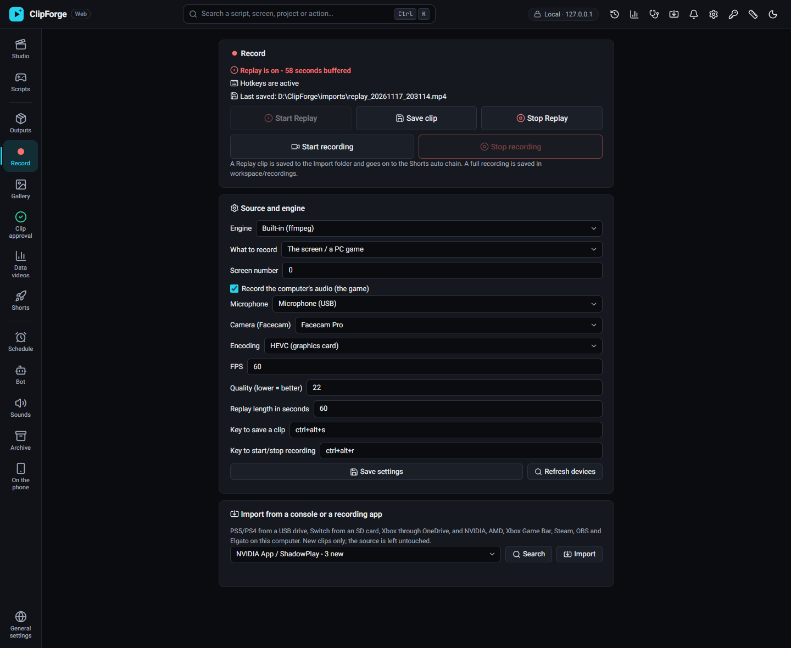
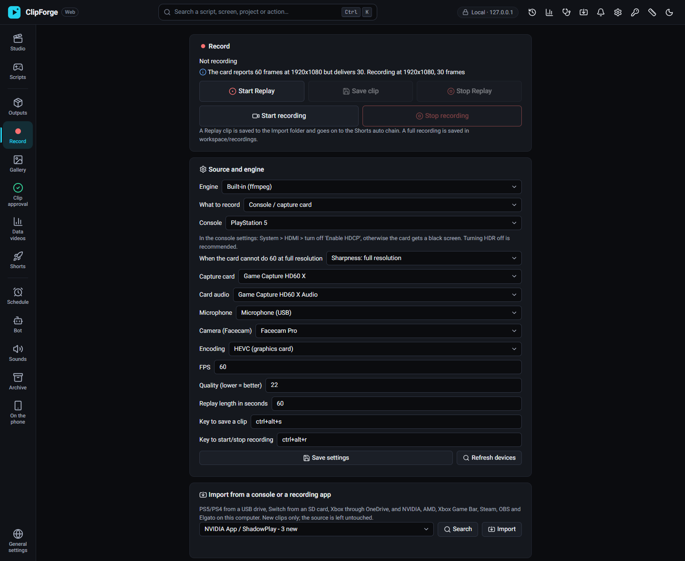
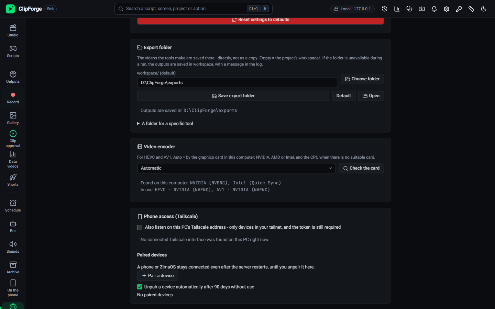
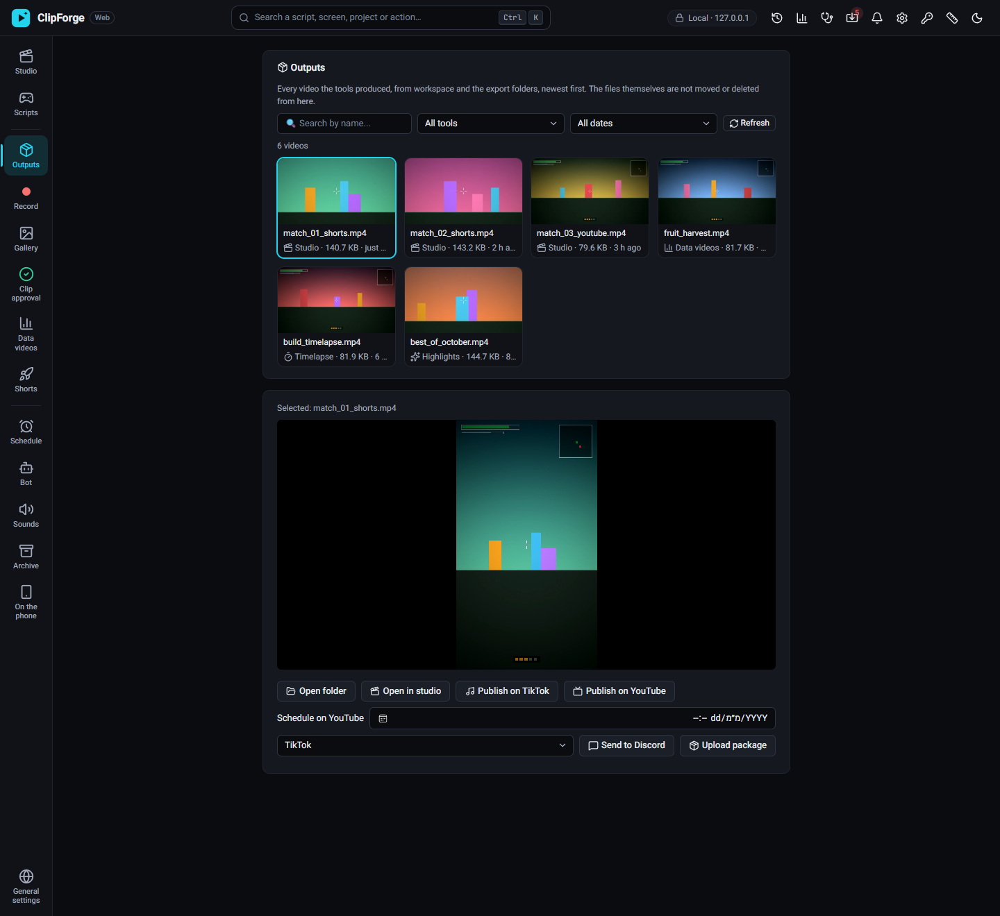
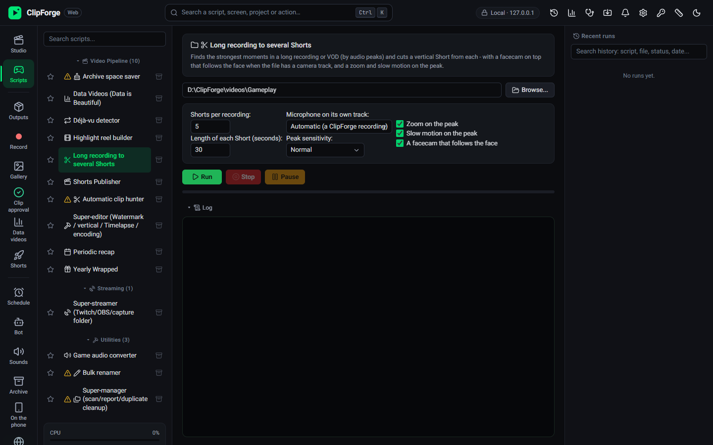

# Changelog

What changed in each ClipForge release, by topic. Dates are release dates (YYYY-MM-DD).

## 2.0.1 - 2026-11-17

The first full release of 2.0. Version 2.0.0 was up for a few hours as a pre-release; 2.0.1 adds the two features it
was missing and fixes what a deep check of the new code found. If you are coming from 1.2.0, everything below is new.

### Recording

- A Recording screen. Record the screen or a PC game with the built-in recorder, or a console (PlayStation 5 and 4, Xbox
  Series and One, Nintendo Switch and Switch 2) through a capture card. Each console has a profile that picks the best
  mode the card offers, with a note about HDCP or the dock where it matters.
- A replay buffer: keep the last 10 seconds to 10 minutes in the background and save them as a clip with a button or a
  global hotkey. The saved clip goes to the Import folder and on to the Shorts auto chain, also while a full recording
  is running.
- The computer's audio (the game) and the microphone are recorded as separate tracks, and a webcam as a second video
  track. A full recording is saved as MKV while recording, so a crash doesn't lose it, and becomes an MP4 when you stop.
- Control OBS from the same screen instead of the built-in recorder: start and stop recording, the replay buffer, and
  switching scenes.
- The recorder stops when ClipForge stops, however it was closed, and cleans up after a run that was cut short.
- When the computer's audio cannot be opened, the recording starts without it and says so. When the fast screen capture
  does not start (some full-screen games, older PCs), the plain one is used instead.
- A capture card is measured before its first recording. Many USB cards report 1080p at 60 frames and deliver 30; the
  recording then uses what the card really delivers, and the screen says so. A new setting chooses what to prefer in
  that case: sharpness (the full resolution, the default) or smooth motion (a lower resolution that really does 60).
- Picture, game audio, microphone and camera share one clock, so they stay in sync however long each takes to start.
- Tested on real hardware: an Xbox through a USB capture card (1080p), and the screen with the computer's audio in 4K.

- Import clips from other recorders and consoles with one click: NVIDIA App / ShadowPlay, AMD ReLive, Xbox Game Bar,
  Steam clips, OBS, Elgato, a PS5 or PS4 USB drive, a Switch SD card, and Xbox captures in OneDrive. Only new clips are
  copied, and the source is never changed.

### Graphics cards

- HEVC and AV1 now encode on AMD (AMF) and Intel (Quick Sync) cards as well as NVIDIA, and on the CPU when there is no
  suitable card. ClipForge detects the card; General settings has an encoder choice, and "Check the card" looks again
  after a driver update or a new card. On NVIDIA nothing changes.
- Tested on real hardware: NVIDIA (HEVC, AV1) and Intel Quick Sync (HEVC). AMD encoding was checked against the ffmpeg
  commands only.

### Platforms

- Upload packages for TikTok, Instagram Reels, Twitch and Kick, from the Outputs screen: a folder with the video, a
  caption that fits the platform's limit, and the thumbnail. The caption is copied and the upload page opens.
- YouTube uploads get chapters (from the chapters in the file), `#Shorts` for vertical clips up to 3 minutes, scheduled
  publishing, and captions from an `.srt` file next to the video. The first upload with captions asks for one more
  permission from YouTube.
- Send to Discord: the bot posts the video to the channel you set with `/clip_channel`, and the screen tells you
  whether it was sent.
- New studio targets: Twitch, Kick and Discord up to 50MB.

### New in the studio

- A new script, "Long recording to several Shorts": finds the strongest moments in a long recording or VOD and cuts a
  vertical Short from each. On the peak it zooms in and plays one second in slow motion. When the file has a camera
  track, the facecam sits on top and its frame follows your face. The microphone of a ClipForge recording is mixed in
  by itself.
- Mix a separate microphone track over the game track, with its own volume, noise reduction on the microphone only,
  and the game lowered while you talk.
- `.ts`, `.flv` and `.m4v` files are picked up everywhere.

### Install and update
- Ready for winget, next to Scoop and the zip: the zip now has a `ClipForge.exe`, and a winget install keeps your data
  in `%LOCALAPPDATA%\ClipForge`, so an upgrade doesn't touch it. The package is not in the winget catalog yet.
- The update banner shows the command that fits how ClipForge was installed (Scoop, winget, zip or git).
- Your connections survive an update: `.env`, the YouTube sign-in and the TikTok cookies are kept when Scoop or winget
  replaces the install folder.
- Starting ClipForge while an older version is still running now says so, instead of opening the old one.
- A new winget install keeps its data in the same folders by topic as every other install (it started in the old flat
  layout).

### Fixed since 2.0.0
- Recording: the computer's audio ran 0.3 seconds ahead of the picture, and a microphone or camera drifted by however
  long it took to open.
- Capture cards: a card that reports 60 frames and delivers 30 produced a 30-frame recording labelled 60, and its
  replay clips reported 240 frames a second, which the studio would have rendered at 240.
- Recording: track names were lost when a recording became an MP4, so the microphone track was not found by itself.
- Recording with OBS: the WebSocket password is saved from the Recording screen. The screen said it was "kept in the
  vault" but had no field for it, so the only way was editing `.env` by hand.
- Capture cards: when another app holds the card (OBS, the Camera app), the screen says so instead of showing a raw
  FFmpeg error. A recording that did not start is now explained in English too.
- Studio: a render that failed on the graphics card's encoder was marked as failed; it is now finished on the CPU.
- Recording: a recorder left running after ClipForge was closed by force kept writing to the disk without limit.
- Recording: a replay clip in AV1 was unreadable (the replay now records in HEVC), a replay saved during a full
  recording went to the wrong folder, and two saves in the same second overwrote each other.
- Recording with OBS: each saved replay was handled twice, a wrong password was reported as "OBS is not open", and a
  full OBS recording went into the Shorts chain.
- Capture cards: 1080p60 is now preferred over 4K30, and 59.94 fps is no longer cut to 59.
- Long recording to Shorts: the zoom on the peak was stuck to the top-left corner, loud recordings never produced a
  moment, the script could not be configured from the browser, and an existing Short was overwritten.
- Studio: a microphone track that the file does not have failed the render; microphone volume 0 was treated as 1.
- Encoders: AV1 on AMD came out almost uncompressed, AV1 on the CPU failed with the ffmpeg in the download, and a
  failed card check was remembered for ever.
- Publishing: YouTube captions never uploaded, and "Publish after editing" or an upload package could overwrite a
  video when two files had the same name.
- Send to Discord: a clip sent before the channel was set failed for good after 45 seconds, and the screen said "sent"
  whatever happened.
- Bot: the daily test render failed every day with a timeout, the stuck-render warning could never fire, and a
  `/run_script` crash with a long output showed no alert.
- Import: "Import from OBS" copied every video in the Videos folder, an Import folder inside a source was imported
  into itself, the same USB drive under another letter was imported again, and a failed copy left a cut-off video.
- Security: `.env`, the YouTube token and the TikTok cookies in the install folder could be downloaded through the
  app's download link. They are now refused, like everything under `data/`.

### Fixes
- Security: a file under `data/` (the access token, the settings) could be downloaded through a `\\?\` or
  `\\localhost\C$` path. Path checks now see through these forms.
- "Publish after editing" and the auto chain published the folder from the Shorts settings instead of the new outputs.
- The gallery shows clips in the per-game folders.
- A file name with Hebrew letters made silence trimming do nothing.
- Discord `/run_script` failed in the middle of a long render and left it running without the render lock.
- Approving a clip failed when the Import folder was on another drive, and could overwrite a clip with the same name.
- A render longer than 4 hours could lose the render lock to another process.
- Importing settings, and saving the Shorts settings, could leave a broken file if interrupted.
- An export folder that is the root of a drive (`F:\`) was refused.

### Security
- opentelemetry-api 1.45.2 (CVE-2026-126360).
- Code scanning: the release workflow is read-only except for the job that publishes, and a CodeQL configuration leaves
  out the two queries that flag what a local, single-user app does by design, so a new finding of another kind is seen.
- `dev/leak_check.py` scans what a branch adds for secrets and personal details before a push, including its commit
  messages and authors. It also runs as a `pre-push` hook.

## 2.0.0 - 2026-11-16

A pre-release of 2.0, replaced by 2.0.1 the next day. Everything it had is listed under 2.0.1.

## 1.2.0 - 2026-11-08

### New in the studio
- A corner radius for the frame effect (`--frame-radius`): the video sits in a frame with rounded inner corners. 0 keeps
  the straight frame.
- A file name layer burns the name of the source file being rendered onto the output, next to the timestamp layer. Quotes,
  spaces and `%` in a file name are safe.
- A caption line length (`--caption-max-chars`): burned captions wrap at the last space before the limit, never inside a
  word, and Hebrew niqqud isn't counted. The SRT and VTT files you export stay unwrapped. It is saved with styles and brand
  kits.

### Fixes
- English UI: the live player's sample caption stays English when it wraps, the file name layer has its own label in the
  layers list, and a layer without an end time shows "End" instead of Hebrew.

### Security
- oauthlib 4.0.1 (CVE-2026-49272 is in the OAuth device-code server flow, which ClipForge doesn't use) and pyasn1 0.6.5
  (four advisories about slow decoding of crafted input).

### Docs
- A redesigned README in English and Hebrew, with new screenshots (Simple mode, branding) and demo GIF, a "Your first video
  in 5 minutes" guide on the docs site, and a SUPPORT.md.

## 1.1.3 - 2026-10-30

### Fixes
- English UI: no flash of Hebrew before the language is applied on load.
- English UI: the time left in a run, the built-in style names and the data-video editor's default labels are translated.
- Run notifications show a readable summary (created, failed, time, size) in the install's language, with no file paths.
- Marking notifications as read no longer stalls the server while the database is busy.

### Public release
- Install with Scoop (`scoop bucket add clipforge https://github.com/DrummingBird1/scoop-clipforge`).
- A documentation site (goes live with GitHub Pages), a roadmap, and a script for the demo video.
- CI, CodeQL and Scorecard workflows, and SHA-pinned actions, ready for the public repository.

## 1.1.2 - 2026-10-30

### Public release
- README: a demo GIF, badges and a Troubleshooting section, in English and Hebrew.
- `SHA256SUMS.txt` next to every portable zip, and the zip's hash in the release notes.
- A smaller portable package: about 133MB less unpacked (only the YouTube discovery documents, no library tests or type
  stubs).
- The tray menu, the launcher's error message and Windows notifications follow the install language.

### Fixes
- The "another render is running" badge clears when the render lock is released.

## 1.1.1 - 2026-10-30

### Security
- filelock 4.2.4 (from 4.1.0) and setuptools 84.2.1 (from 84.0.0) for open security advisories; the portable zip now
  ships filelock 4.2.4.

### Public release
- The public repository no longer gets a Dependabot configuration; dependency updates come with each release.

## 1.1.0 - 2026-10-30

### Public release
- English UI by default on a new install; existing installs keep Hebrew. Texts the server makes (default titles, Wrapped
  cards, device names, new data-video episodes) follow the install's language.
- "Rocket Shorts" is now the Shorts publisher: a configurable file-name prefix and game, output at the source resolution
  or 4K, an optional logo, and CPU encoding (libx264) by default.
- Neutral defaults for new installs: the RSS keyword filter, the Steam store region and language, and the Docker
  container are settings; the daily maintenance and digest run on local time; the disk scanner starts in the home
  folder.
- The shared database is now `clipforge_data.db`, renamed automatically on first start, with a backup first.
- A new install starts in the topic folders, and the web app can be installed as a PWA.
- A portable Windows zip with a pinned FFmpeg build (GPLv3 essentials), and an update check against the public
  repository's releases.
- Community files: a contributing guide, a security policy, and issue and pull request templates.

### Graph editor (data-to-video)
- New episodes from several data files at once, or from a ready episode folder; add, remove and edit data sources later,
  including a data grid that saves a new file and weights files.
- Level sources (values that are levels, not amounts to add up), series in different units on a second y-axis or as
  small multiples, and a fill for sparse data (steps or a straight line).
- A smart editor: point it at a data folder and get an episode draft, with column roles, units, chart choice, story,
  events, titles, a YouTube package and a thumbnail - each choice with a reason and a confidence. It also watches a folder
  and learns preferences per channel kit.
- A data-source catalog (CBS, World Bank, OECD), downloaded only on request.
- Story tools: a wizard (race, trend, compare two, before/after), annotations on the chart, focus mode, a narration
  script draft, a fact check of on-screen numbers against their source rows, and a readability check per target.
- A live animated preview, version history and named variants per episode, a trash with restore, and an image report
  for a whole folder of episodes.
- Simple, regular and expert levels, first-run onboarding, one tools menu and one settings dialog.
- Rendering: an interrupted full render resumes from the last finished piece, a time estimate for automatic Shorts, and
  a clear error when a drawing worker dies. Many reading, date and drawing fixes from a full bug hunt.

### Studio (video editor)
- Usability fixes from a full walkthrough: a folder picker with recent folders, where each output was saved, logo
  overlap warnings and box-based safe zones, a timeline docked at the bottom, the output's loudness (LUFS), and new
  projects from a template.

### Web app and phone
- Outputs screen: every video the tools produced, in one place, and publishing from any output.
- Notification center: what finished, stopped or failed, in one list.
- Phone screen: what is running, the queue, approvals and run-again; phone access over Tailscale (opt in), and pairing
  a device once with its own token.
- One export folder for every tool's final outputs, or a folder per tool.
- The end of a run (history, webhook, backup, night mode) happens even with no browser tab open, and night mode waits
  for the end of the queue before shutting down.
- An optional Windows wake timer for the next scheduled task.

### Data and storage
- Outputs are organized by tool under `workspace/<tool>/`, with a migration script for existing outputs.
- `data/` is organized by topic (`settings/`, `security/`, `bot/`, `studio/`, `dataviz/`, `cache/`), with a migration
  script that backs up first and rolls back on failure.

### Security and dependencies
- Pillow 13 and certifi 2026.10.19 for open security alerts; Python 3.11 or newer.
- Tests can no longer reach the network outside localhost.

### Reliability
- The render lock survives a reader on Windows and a lock file being deleted.
- Fixes for the NVENC probe, Discord approval retries, Docker status timeouts and Hebrew number labels.

### Development
- `src/utils/` split into `video/`, `media/`, `bot/` and `shared/`; tests split by area; the web server split into
  smaller modules; developer tools moved to `dev/`.
- Faster test runs (each worker gets its own data and workspace folders).
- MIT license and third-party notices.

## 1.0.0 - 2026-10-16

The first release: the Discord bot, the desktop control center and the browser app, the studio (video editor), the
graph editor, timelapses and highlight reels, Shorts publishing, scheduling and backups.
