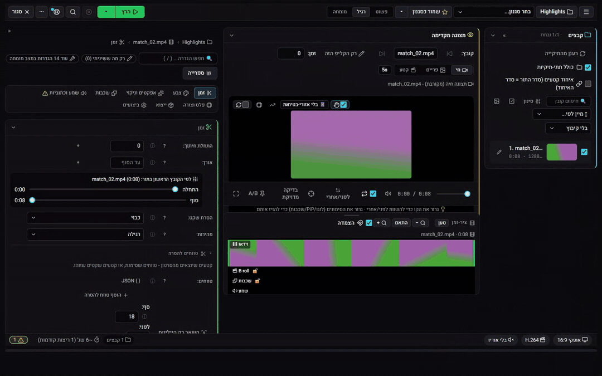
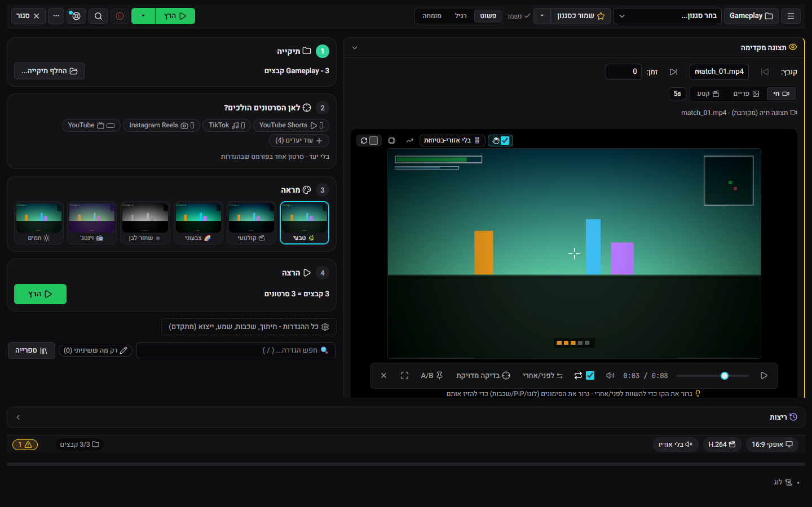
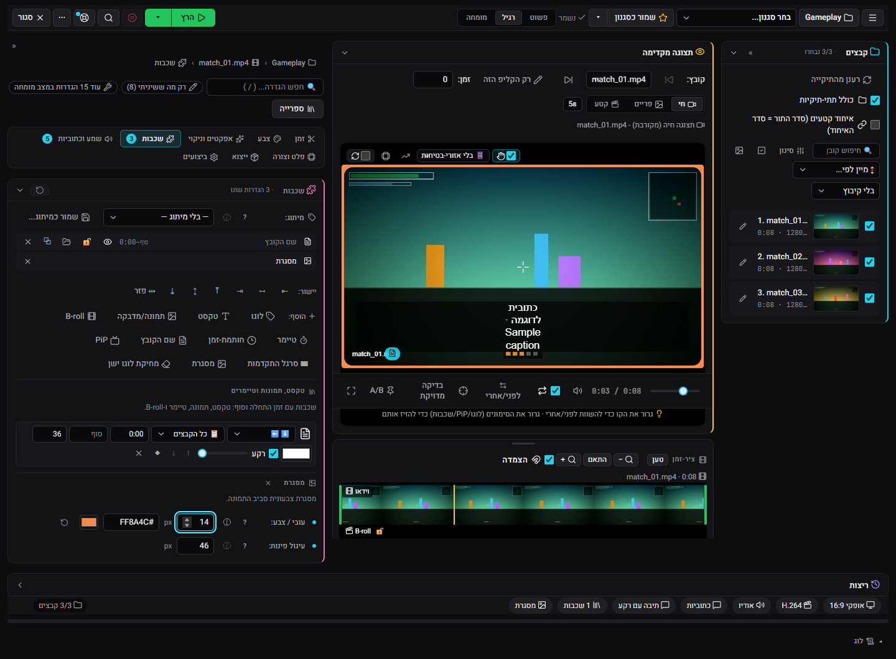

<div dir="rtl">

# ClipForge

**סטודיו וידאו לקליפים ממשחקים ולסרטוני נתונים, שרץ על מחשב ה-Windows שלכם.** עורכים, ממתגים ומייצאים סרטונים ל-Shorts, ל-TikTok וליוטיוב מהדפדפן, ושום דבר לא עולה לשום מקום אם לא ביקשתם.

[הורדה](https://github.com/DrummingBird1/clipforge-app/releases/latest) · [התקנה עם Scoop](#או-עם-scoop) · [הסרטון הראשון שלכם (באנגלית)](docs/getting_started.md) · [אתר התיעוד (באנגלית)](https://drummingbird1.github.io/clipforge-app/) · [English](README.md)

[](https://github.com/DrummingBird1/clipforge-app/releases/latest)
[](https://github.com/DrummingBird1/clipforge-app/releases)
[](https://github.com/DrummingBird1/clipforge-app/actions/workflows/ci.yml)
[](LICENSE)




## למה ClipForge

- 🔒 **מקומי קודם.** הקליפים שלכם לא עוזבים את המחשב. הסטודיו, סרטוני הנתונים ומסך התוצרים לא צריכים חשבון ולא מפתח.
- 🎯 **ריצה אחת, כל היעדים.** גרסאות ל-Shorts, ל-TikTok, לאינסטגרם וליוטיוב יוצאות מריצה אחת, כל אחת בפורמט שלה.
- ⚡ **מהיר עם כרטיס NVIDIA, וגם בלעדיו.** הייצוא משתמש במקודד של כרטיס המסך (NVENC) כשיש כזה, ובמעבד כשאין.
- 🧰 **אין מה להתקין.** מחלצים, לוחצים פעמיים על `ClipForge.vbs`, והוא נפתח בדפדפן. כדי להסיר מוחקים את התיקייה.
- 🆓 **חינמי ופתוח.** רישיון MIT.

## מה הוא עושה

- **סטודיו.** עורך וידאו בדפדפן. מצב **פשוט** מוביל מתיקייה לסרטונים מוכנים בארבעה צעדים (תיקייה, לאן הסרטונים הולכים, מראה, הרצה), ומצבי **רגיל** ו**מומחה** פותחים כל הגדרה. חיתוך, המרה לאנכי, שכבות (טקסט, תמונות, לוגו או סימן מים, מסגרת, שם הקובץ), כתוביות ונרמול עוצמה, ואז ייצוא לכמה יעדים (Shorts, ‏TikTok, אינסטגרם, יוטיוב) בריצה אחת. הנגן החי מראה את התוצאה בזמן העריכה. לכל תיקייה יש פרויקט משלה, ואפשר לשמור את המראה כסגנון או כתבנית.
- **סרטוני נתונים.** הופכים טבלה לסרטון גרף מונפש (מרוץ עמודות, קווים, מפות), עם כותרות, קריינות וכתוביות.
- **תוצרים.** כל הסרטונים שיצרתם במקום אחד, עם נגן ופעולות מהירות.
- **מסך טלפון.** רואים מה רץ, מאשרים קליפים ומריצים שוב מהטלפון.
- **מרכז ההתראות.** ריצות שהסתיימו, כישלונות, וכל מה שמחכה לכם.
- **אוטומציה, לבחירתכם.** זיהוי קליפים, כותרות ותיאורים עם AI, העלאה ליוטיוב, בוט דיסקורד, ייבוא קליפים מ-Twitch ומעקב אחרי ה-Replay של OBS. כל אחד מהם כבוי עד שמגדירים אותו (ראו [תכונות אופציונליות](#תכונות-אופציונליות)).

## מבט מבפנים


| | |
|---|---|
|  |  |
| מצב פשוט: תיקייה, לאן הסרטונים הולכים, מראה והרצה | מיתוג, חי בנגן: מסגרת עם פינות מעוגלות, שם הקובץ וכתוביות שנשברות בשורות |
|  |  |
| עורך הגרפים | תוצרים |
|  |  |
| מסך הטלפון | מרכז ההתראות |

## התקנה

1. מורידים את קובץ ה-zip של ClipForge מה-[Release האחרון](../../releases/latest).
2. מחלצים אותו לתיקייה שבוחרים, למשל `C:\ClipForge`.
3. לוחצים לחיצה כפולה על `ClipForge.vbs`. ‏ClipForge נפתח בדפדפן.

אין תוכנת התקנה ולא צריך הרשאות מנהל. הכל נשאר באותה תיקייה, ולכן כדי להסיר את ClipForge פשוט מוחקים אותה.

### או עם Scoop

מי שמשתמש ב-[Scoop](https://scoop.sh):

```powershell
scoop bucket add clipforge https://github.com/DrummingBird1/scoop-clipforge
scoop install clipforge
```

אחר כך מפעילים את ClipForge מתפריט התחל. ‏`scoop update clipforge` מתקין גרסה חדשה, וההגדרות והסרטונים (`data` ו-`workspace`) נשמרים בין עדכונים.

### דרישות

- ‏Windows 10 או 11, ‏64 ביט.
- כרטיס מסך של NVIDIA לא חובה. עם כרטיס כזה הייצוא משתמש במקודד של הכרטיס (NVENC) ומסתיים הרבה יותר מהר. בלעדיו ClipForge מקודד על המעבד.
- מקום בדיסק לתוכנה (בערך 1GB) ולסרטונים שלכם.

## הסרטון הראשון שלכם

1. לוחצים על **סטודיו** בסרגל הצד, אחר כך על **בחר תיקייה**, ובוחרים תיקייה עם כמה קליפים.
2. תחת **לאן הסרטונים הולכים?** מסמנים Shorts, ‏TikTok או יוטיוב, ובוחרים **מראה**.
3. לוחצים **הרץ**. הסרטונים מופיעים ב**תוצרים**.

הדרכה מלאה עם צילומי מסך (באנגלית): [Your first video in 5 minutes](docs/getting_started.md).

## תכונות אופציונליות

הסטודיו, עורך הגרפים ומסך התוצרים עובדים בלי חשבון ובלי מפתח. כל אחת מהתכונות למטה צריכה חשבון או מפתח משלכם. בלעדיהן ClipForge עובד אותו דבר, רק בלי התכונה הזו.

| תכונה | מה צריך | איך מגדירים |
|---|---|---|
| בוט דיסקורד: אישור קליפים והרצת משימות מדיסקורד | טוקן של בוט דיסקורד | `DISCORD_TOKEN` |
| כותרות, תיאורים וזיהוי קליפים עם AI ‏(Gemini) | מפתח API של Gemini | `GEMINI_API_KEY` |
| העלאה ליוטיוב ונתוני הערוץ | לקוח OAuth מסוג "Desktop app" ל-YouTube Data API v3, מ-Google Cloud | שומרים אותו בשם `client_secret.json` בתיקיית ClipForge. בהעלאה הראשונה תתבקשו להתחבר. |
| ייבוא קליפים מ-Twitch | אפליקציה של Twitch (מזהה וסוד) ושם הערוץ | `TWITCH_CLIENT_ID`, ‏`TWITCH_CLIENT_SECRET`, ‏`TWITCH_CHANNEL_NAME` |
| מעקב Replay של OBS | ‏OBS עם שרת ה-WebSocket דלוק (Tools, ‏WebSocket Server Settings) | `OBS_WEBSOCKET_PORT` (ברירת מחדל 4455), ו-`OBS_WEBSOCKET_PASSWORD` אם הגדרתם סיסמה |

המפתחות נכנסים לקובץ טקסט בשם `.env` בתיקיית ClipForge, אחד בכל שורה, למשל `GEMINI_API_KEY=המפתח-שלכם`. מוסיפים רק את מה שמשתמשים בו. מסך האבחון 🩺 מראה אילו מפתחות מוגדרים, ויכול לבדוק שהם עדיין עובדים.

## פרטיות

- הכל רץ על המחשב שלכם. הסרטונים, הפרויקטים וההגדרות נשארים בתיקיית ClipForge (`data/` ו-`workspace/`).
- מסך הדפדפן זמין רק בכתובת `127.0.0.1` (localhost), ונדרש בו טוקן גישה שמתחלף בכל הפעלה של ClipForge. פתיחה מהטלפון או מהרשת המקומית כבויה עד שמדליקים אותה.
- ‏ClipForge מתחבר לאינטרנט רק בשביל התכונות שהגדרתם (Gemini, יוטיוב, דיסקורד, Twitch), כדי לבדוק ב-GitHub אם יש גרסה חדשה, וכדי להוריד מודל של זיהוי דיבור בפעם הראשונה שמשתמשים בכתוביות.

## פתרון בעיות

**"Windows protected your PC" כשפותחים את `ClipForge.vbs`.**
‏ClipForge לא חתום בתעודת חתימת קוד, ולכן Windows SmartScreen מזהיר עליו כמו על כל קובץ לא חתום מהאינטרנט. לוחצים על **More info** (מידע נוסף), ואז על **Run anyway** (הפעל בכל זאת). כדי שהאזהרה לא תופיע על הקבצים שחולצו, לוחצים לחיצה ימנית על קובץ ה-zip *לפני* החילוץ, בוחרים **Properties** (מאפיינים), מסמנים **Unblock** (בטל חסימה) ולוחצים **OK**. כדי לוודא שה-zip הוא זה שפורסם, משווים את ה-SHA-256 שלו להערות הגרסה או לקובץ `SHA256SUMS.txt` שבעמוד ה-Release. ב-PowerShell: `Get-FileHash .\ClipForge-<version>-win64.zip`.

**האנטי-וירוס חוסם קובץ או מכניס אותו להסגר.**
‏`ClipForge.vbs` הוא סקריפט קטן שמפעיל את הפייתון שבחבילה (`launcher.pyw`) בלי חלון קונסולה, ויש תוכנות אנטי-וירוס שמסמנות מפעילים כאלה לפי היוריסטיקה. בודקים את ה-SHA-256 של ה-zip כמו למעלה, משחזרים את הקובץ, ומוסיפים את תיקיית ClipForge כחריגה. קובצי ה-zip של הגרסאות נבנים מקוד המקור של הריפו הזה עם `dev/build_portable.py`, ואת ה-SHA-256 שלהם בודקים מול הערות הגרסה. כש-CI ירוץ בריפו הציבורי, הגרסאות ייבנו ב-GitHub Actions ויגיעו עם אישור בנייה (build attestation), שאפשר לבדוק עם `gh attestation verify`.

**אין לי כרטיס מסך של NVIDIA.**
הכל עובד על המעבד, רק לאט יותר. פלט H.264 בסטודיו ופרופיל ברירת המחדל של פרסום ה-Shorts (CPU Fallback, ‏H.264) משתמשים במקודד של המעבד. ‏HEVC ו-AV1 בסטודיו, ופרופילי ה-NVENC של פרסום ה-Shorts, צריכים כרטיס NVIDIA. במקומם בוחרים H.264 או את פרופיל המעבד.

**הפורט 8878 תפוס.**
‏ClipForge מאזין בכתובת `127.0.0.1:8878`. כשמשהו כבר עונה בפורט הזה, `ClipForge.vbs` מניח ש-ClipForge כבר רץ ורק פותח את הדפדפן. לכן אם תוכנה אחרת משתמשת בפורט, נפתח הדף שלה או שגיאה במקום ClipForge. מוצאים אותה עם `netstat -ano | findstr :8878` (העמודה האחרונה היא מזהה התהליך, שמנהל המשימות מציג בלשונית Details), סוגרים אותה ומפעילים את ClipForge שוב.

**איפה הנתונים שלי?**
בתיקיית ClipForge, ליד `ClipForge.vbs`: ההגדרות, מסד הנתונים והלוגים ב-`data/`, והסרטונים, התוצרים והפרויקטים ב-`workspace/` (או בתיקיית הייצוא שבחרתם בהגדרות). המפתחות ב-`.env` באותה תיקייה, וההתחברות ליוטיוב ב-`client_secret.json` וב-`youtube_token.json`.

**איך מעדכנים לגרסה חדשה?**
‏ClipForge מודיע כשיוצאת גרסה חדשה ומקשר לעמוד ה-Release. עוצרים את ClipForge (לחיצה ימנית על הסמל שלו במגש המערכת, **כבה שרת**), מחלצים את ה-zip החדש לתיקייה חדשה, ומעתיקים אליה מהתיקייה הישנה את `data/`, ‏`workspace/`, ‏`.env` ואת קובצי יוטיוב (`client_secret.json`, ‏`youtube_token.json`). מפעילים את `ClipForge.vbs` החדש, ומוחקים את התיקייה הישנה אחרי שהכל עובד.

כדי לחסוך את ההעתקה בפעם הבאה, אפשר לשמור את הנתונים מחוץ לתיקיית התוכנה: מעבירים את `data/` ואת `workspace/` לתיקיות שבוחרים, ומגדירים את משתני הסביבה של המשתמש `CLIPFORGE_DATA_DIR` ו-`CLIPFORGE_WORKSPACE_DIR` אליהן (בהגדרות של Windows: "עריכת משתני סביבה עבור החשבון שלך"). מאז, גרסה חדשה רק צריך לחלץ.

**איך מסירים?**
עוצרים את ClipForge (סמל המגש, **כבה שרת**) ומוחקים את התיקייה שלו. ‏ClipForge לא מתקין שום דבר אחר, חוץ משני מקרים:
- אם הפעלתם את טיימר ההשכמה, מכבים אותו קודם בהגדרות, או מוחקים את המשימה `ClipForge\WakeForNextTask` ב-Task Scheduler (מתזמן המשימות).
- אם הגדרתם webhook של דיסקורד להתראות על סרטוני נתונים, הוא שמור ב-Windows Credential Manager (מנהל האישורים, Windows Credentials, ברשומה שמסתיימת ב-`@RocketLauncher`).

## רישיון

‏ClipForge מופץ ברישיון MIT, ראו [LICENSE](LICENSE). רכיבים של צד שלישי, כולל ה-ffmpeg שמגיע עם ה-Release, נשארים ברישיונות שלהם, שמפורטים בהודעות שמגיעות איתו.

## למפתחים

הרצה מקוד המקור, טסטים ומבנה הקוד: [docs/development.md](docs/development.md). מה מתוכנן בהמשך: [ROADMAP.md](ROADMAP.md) (באנגלית).

</div>
