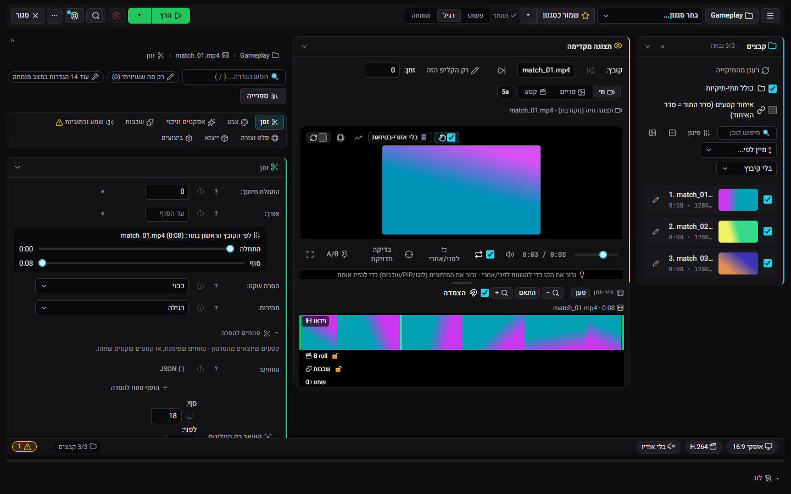
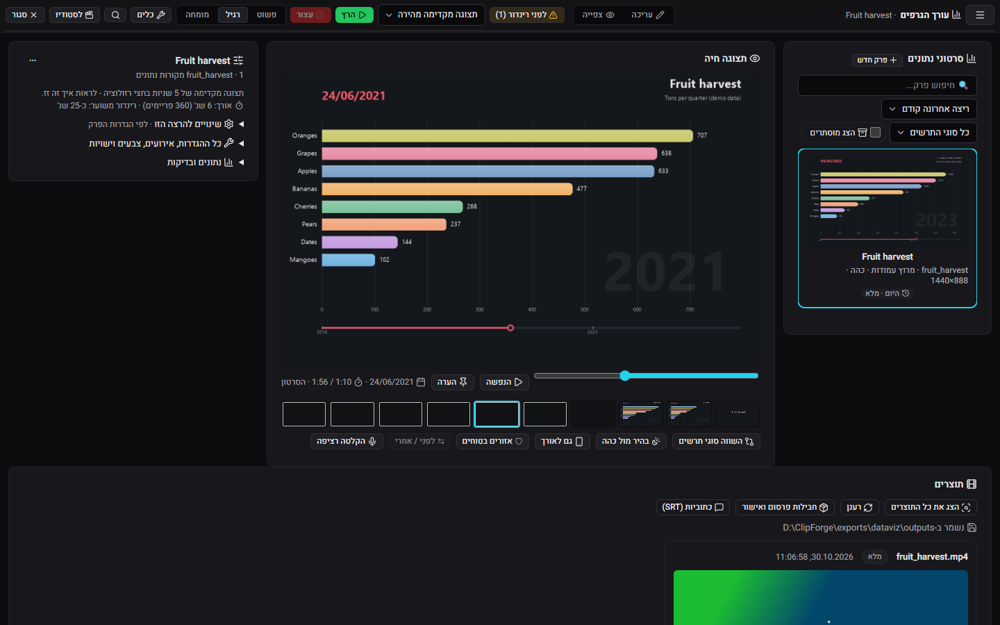
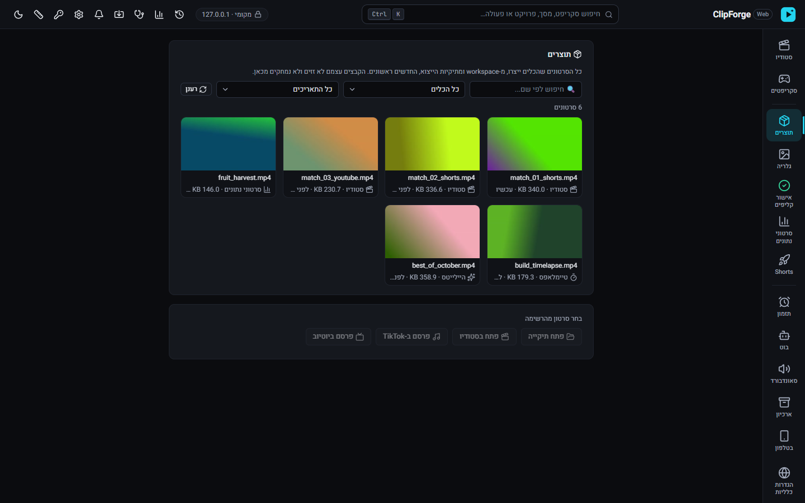
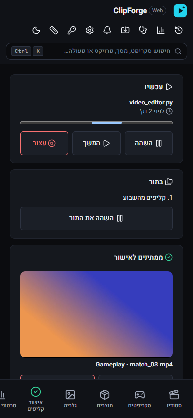
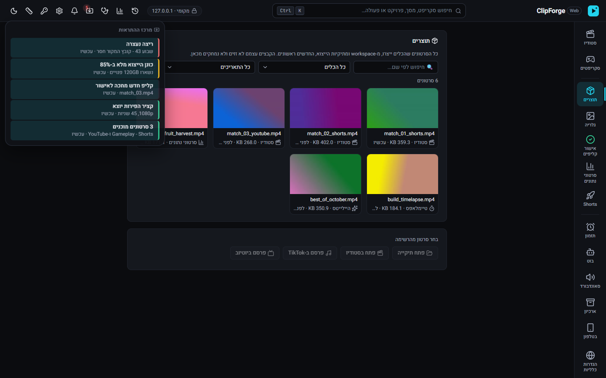

# ClipForge

סטודיו וידאו לקליפים ממשחקים ולסרטוני נתונים, שרץ על מחשב ה-Windows שלכם. עורכים, ממתגים ומייצאים סרטונים ל-Shorts, ל-TikTok וליוטיוב מהדפדפן, ושום דבר לא עולה לשום מקום אם לא ביקשתם.

[English](README.md)

## מה הוא עושה

- **סטודיו.** עורך וידאו בדפדפן: חיתוך, המרה לאנכי, שכבות טקסט ותמונה, לוגו או סימן מים, כתוביות ונרמול עוצמה, ואז ייצוא לכמה יעדים (Shorts, ‏TikTok, אינסטגרם, יוטיוב) בריצה אחת. הנגן החי מראה את התוצאה בזמן העריכה. לכל תיקייה יש פרויקט משלה, ואפשר לשמור את המראה כסגנון או כתבנית.
- **סרטוני נתונים.** הופכים טבלה לסרטון גרף מונפש (מרוץ עמודות, קווים, מפות), עם כותרות, קריינות וכתוביות.
- **תוצרים.** כל הסרטונים שיצרתם במקום אחד, עם נגן ופעולות מהירות.
- **מסך טלפון.** רואים מה רץ, מאשרים קליפים ומריצים שוב מהטלפון.
- **מרכז ההתראות.** ריצות שהסתיימו, כישלונות, וכל מה שמחכה לכם.
- **אוטומציה, לבחירתכם.** זיהוי קליפים, כותרות ותיאורים עם AI, העלאה ליוטיוב, בוט דיסקורד, ייבוא קליפים מ-Twitch ומעקב אחרי ה-Replay של OBS. כל אחד מהם כבוי עד שמגדירים אותו (ראו [תכונות אופציונליות](#תכונות-אופציונליות)).

| | |
|---|---|
|  |  |
| עורך הגרפים | תוצרים |
|  |  |
| מסך הטלפון | מרכז ההתראות |

## התקנה

1. מורידים את קובץ ה-zip של ClipForge מה-[Release האחרון](../../releases/latest).
2. מחלצים אותו לתיקייה שבוחרים, למשל `C:\ClipForge`.
3. לוחצים לחיצה כפולה על `ClipForge.vbs`. ‏ClipForge נפתח בדפדפן.

אין תוכנת התקנה ולא צריך הרשאות מנהל. הכל נשאר באותה תיקייה, ולכן כדי להסיר את ClipForge פשוט מוחקים אותה.

### דרישות

- ‏Windows 10 או 11, ‏64 ביט.
- כרטיס מסך של NVIDIA לא חובה. עם כרטיס כזה הייצוא משתמש במקודד של הכרטיס (NVENC) ומסתיים הרבה יותר מהר. בלעדיו ClipForge מקודד על המעבד.
- מקום בדיסק לתוכנה (בערך 1GB) ולסרטונים שלכם.

## תכונות אופציונליות

הסטודיו, עורך הגרפים ומסך התוצרים עובדים בלי חשבון ובלי מפתח. כל אחת מהתכונות למטה צריכה חשבון או מפתח משלכם. בלעדיהן ClipForge עובד אותו דבר, רק בלי התכונה הזו.

| תכונה | מה צריך | איך מגדירים |
|---|---|---|
| בוט דיסקורד: אישור קליפים והרצת משימות מדיסקורד | טוקן של בוט דיסקורד | `DISCORD_TOKEN` |
| כותרות, תיאורים וזיהוי קליפים עם AI ‏(Gemini) | מפתח API של Gemini | `GEMINI_API_KEY` |
| העלאה ליוטיוב ונתוני הערוץ | לקוח OAuth מסוג "Desktop app" ל-YouTube Data API v3, מ-Google Cloud | שומרים אותו בשם `client_secret.json` בתיקיית ClipForge. בהעלאה הראשונה תתבקשו להתחבר. |
| ייבוא קליפים מ-Twitch | אפליקציה של Twitch (מזהה וסוד) ושם הערוץ | `TWITCH_CLIENT_ID`, ‏`TWITCH_CLIENT_SECRET`, ‏`TWITCH_CHANNEL_NAME` |
| מעקב Replay של OBS | ‏OBS עם שרת ה-WebSocket דלוק (Tools, ‏WebSocket Server Settings) | `OBS_WEBSOCKET_PORT` (ברירת מחדל 4455), ו-`OBS_WEBSOCKET_PASSWORD` אם הגדרתם סיסמה |

המפתחות נכנסים לקובץ טקסט בשם `.env` בתיקיית ClipForge, אחד בכל שורה, למשל `GEMINI_API_KEY=המפתח-שלכם`. מוסיפים רק את מה שמשתמשים בו. מסך האבחון 🩺 מראה אילו מפתחות מוגדרים, ויכול לבדוק שהם עדיין עובדים.

## פרטיות

- הכל רץ על המחשב שלכם. הסרטונים, הפרויקטים וההגדרות נשארים בתיקיית ClipForge (`data/` ו-`workspace/`).
- מסך הדפדפן זמין רק בכתובת `127.0.0.1` (localhost), ונדרש בו טוקן גישה שמתחלף בכל הפעלה של ClipForge. פתיחה מהטלפון או מהרשת המקומית כבויה עד שמדליקים אותה.
- ‏ClipForge מתחבר לאינטרנט רק בשביל התכונות שהגדרתם (Gemini, יוטיוב, דיסקורד, Twitch), כדי לבדוק ב-GitHub אם יש גרסה חדשה, וכדי להוריד מודל של זיהוי דיבור בפעם הראשונה שמשתמשים בכתוביות.

## רישיון

‏ClipForge מופץ ברישיון MIT, ראו [LICENSE](LICENSE). רכיבים של צד שלישי, כולל ה-ffmpeg שמגיע עם ה-Release, נשארים ברישיונות שלהם, שמפורטים בהודעות שמגיעות איתו.

## למפתחים

הרצה מקוד המקור, טסטים ומבנה הקוד: [docs/development.md](docs/development.md).

