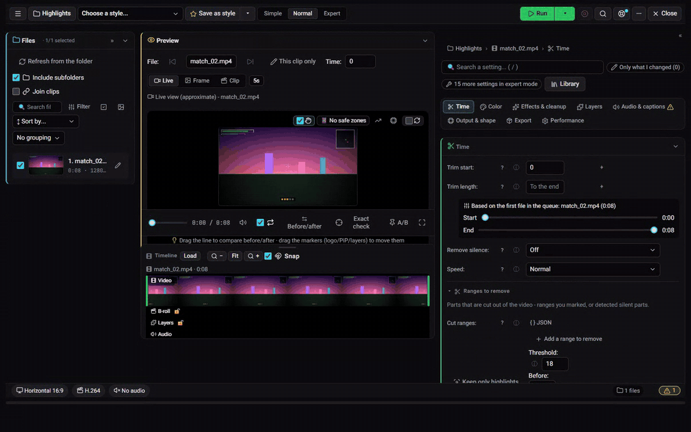
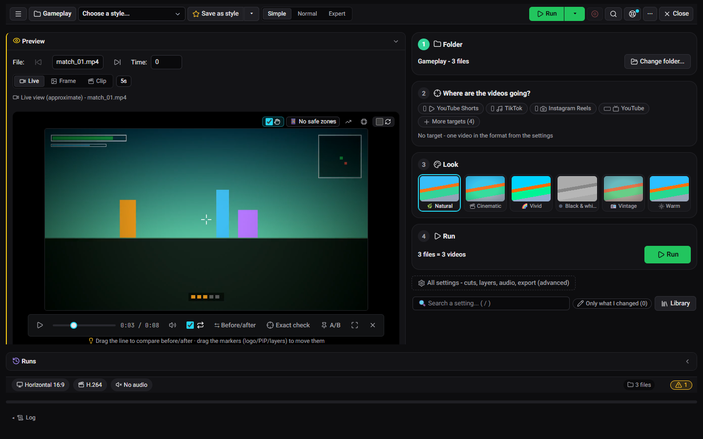
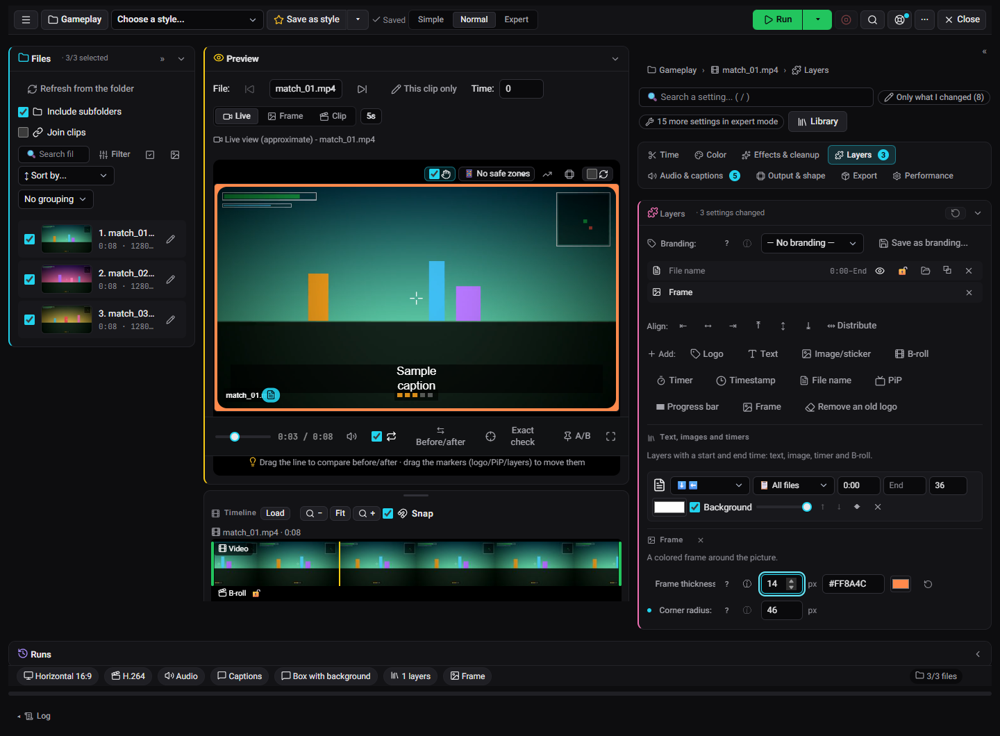

<div align="center" markdown="1">


# ClipForge

**A video studio for gameplay clips and data videos, running on your own Windows PC.**<br>
Edit, brand and export Shorts, TikToks and YouTube videos from your browser, with nothing uploaded anywhere unless you ask for it.

[Download](https://github.com/DrummingBird1/clipforge-app/releases/latest) · [Install with Scoop](#or-with-scoop) · [Your first video](docs/getting_started.md) · [Docs site](https://drummingbird1.github.io/clipforge-app/) · [Roadmap](ROADMAP.md) · [עברית](README.he.md)

[](https://github.com/DrummingBird1/clipforge-app/releases/latest)
[](https://github.com/DrummingBird1/clipforge-app/releases)
[](https://github.com/DrummingBird1/clipforge-app/actions/workflows/ci.yml)
[](LICENSE)




</div>

## Why ClipForge

- 🔒 **Local first.** Your clips never leave your PC. The studio, the data videos and the outputs screen need no account and no key.
- 🎯 **One run, every target.** Shorts, TikTok, Instagram and YouTube versions come out of a single run, each in its own format.
- ⚡ **Fast with an NVIDIA card, fine without.** Exports use the GPU encoder (NVENC) when there is one, and the CPU when there isn't.
- 🧰 **Nothing to install.** Unzip it, double-click `ClipForge.vbs`, and it opens in your browser. Delete the folder to remove it.
- 🆓 **Free and open source.** MIT license.

## What it does

| | |
|---|---|
| 🎞️ **Studio**<br>A video editor in the browser. **Simple** mode takes you from a folder to finished videos in four steps, and **Normal** and **Expert** open every setting. | 📊 **Data videos**<br>Turn a table into an animated chart video (bar races, lines, maps) with titles, narration and captions. |
| 📂 **Outputs**<br>Every video you made, in one place, with a player and quick actions. | 📱 **Phone screen**<br>See what's running, approve clips and run things again from your phone. |
| 🔔 **Notification center**<br>Finished runs, failures and anything that needs you. | 🤖 **Optional automation**<br>Clip detection, AI titles and descriptions, YouTube upload, a Discord bot, Twitch clip import and an OBS replay watcher. Each one is off until you set it up (see [Optional features](#optional-features)). |

In the studio you can:

- Trim, crop to vertical, and add layers: text, images, a logo or watermark, a frame, the file name.
- Add captions and normalize the loudness.
- Export to several targets (Shorts, TikTok, Instagram, YouTube) in one run, with a live player that shows the result as you edit.
- Keep a project per folder, and save your look as a style or a template.

## A look inside


| | |
|---|---|
|  |  |
| Simple mode: a folder, where the videos go, a look, and Run | Branding, live in the player: a frame with rounded corners, the file name and captions that wrap |
|  |  |
| Data videos editor | Outputs |
|  |  |
| Phone screen | Notification center |

## Install

1. Download the ClipForge zip from the [latest release](../../releases/latest).
2. Extract it to a folder of your choice, for example `C:\ClipForge`.
3. Double-click `ClipForge.vbs`. ClipForge opens in your browser.

There's no installer and no admin rights are needed. Everything stays in that folder, so removing ClipForge means deleting the folder.

### Or with Scoop

If you use [Scoop](https://scoop.sh):

```powershell
scoop bucket add clipforge https://github.com/DrummingBird1/scoop-clipforge
scoop install clipforge
```

Then start ClipForge from the Start menu. `scoop update clipforge` installs a new version, and your settings and videos (`data` and `workspace`) are kept between updates.

### Requirements

- Windows 10 or 11, 64-bit.
- An NVIDIA GPU is optional. With one, exports use the GPU encoder (NVENC) and finish much faster. Without one, ClipForge encodes on the CPU.
- Disk space for the app (about 1 GB) and for your videos.

## Your first video

1. Click **Studio** in the left sidebar, then **Choose folder**, and pick a folder with a few clips.
2. Under **Where are the videos going?**, tap Shorts, TikTok or YouTube, and pick a **Look**.
3. Press **Run**. Your videos appear in **Outputs**.

The full walkthrough, with screenshots, is in [Your first video in 5 minutes](docs/getting_started.md).

## Optional features

The studio, the data videos editor and the outputs screen work with no account and no key. The features below each need an account or a key of your own. Without them ClipForge works the same, just without that feature.

| Feature | What you need | How to set it |
|---|---|---|
| Discord bot: approve clips and run tasks from Discord | A Discord bot token | `DISCORD_TOKEN` |
| AI titles, descriptions and clip detection (Gemini) | A Gemini API key | `GEMINI_API_KEY` |
| YouTube upload and channel stats | An OAuth client of type "Desktop app" for the YouTube Data API v3, from Google Cloud | Save it as `client_secret.json` in the ClipForge folder. The first upload asks you to sign in. |
| Twitch clip import | A Twitch app (client ID and secret) and your channel name | `TWITCH_CLIENT_ID`, `TWITCH_CLIENT_SECRET`, `TWITCH_CHANNEL_NAME` |
| OBS replay watcher | OBS with its WebSocket server turned on (Tools, WebSocket Server Settings) | `OBS_WEBSOCKET_PORT` (default 4455) and `OBS_WEBSOCKET_PASSWORD`, if you set one |

Keys go in a text file named `.env` in the ClipForge folder, one per line, for example `GEMINI_API_KEY=your-key`. Add only the ones you use. The 🩺 diagnostics screen shows which keys are set and can check that they still work.

## Privacy

- Everything runs on your PC. Your videos, projects and settings stay in the ClipForge folder (`data/` and `workspace/`).
- The browser screen is served on `127.0.0.1` (localhost) only, and it needs an access token that changes every time ClipForge starts. Opening it from your phone or your local network is off until you turn it on.
- ClipForge goes online only for the features you set up (Gemini, YouTube, Discord, Twitch), to check GitHub for a new version, and to download a speech-to-text model the first time you use captions.

## Troubleshooting

<details markdown="1">
<summary><b>"Windows protected your PC" when I open <code>ClipForge.vbs</code>.</b></summary>

ClipForge isn't signed with a code-signing certificate, so Windows SmartScreen warns about it like any unsigned file from the internet. Click **More info**, then **Run anyway**. To avoid the warning for the extracted files, right-click the zip *before* extracting it, choose **Properties**, tick **Unblock** and click **OK**. To check that the zip is the one that was published, compare its SHA-256 with the release notes or with `SHA256SUMS.txt` on the release page. In PowerShell: `Get-FileHash .\ClipForge-<version>-win64.zip`.

</details>

<details markdown="1">
<summary><b>My antivirus blocks or quarantines a file.</b></summary>

`ClipForge.vbs` is a small script that starts the bundled Python (`launcher.pyw`) without a console window, and some antivirus programs flag launchers like that by heuristics. Check the zip's SHA-256 as above, restore the file, and add the ClipForge folder as an exception. Release zips are built from this repository's source with `dev/build_portable.py`; check the SHA-256 against the release notes. Once CI runs on the public repository, releases are built by GitHub Actions and carry a build attestation (`gh attestation verify`).

</details>

<details markdown="1">
<summary><b>I don't have an NVIDIA graphics card.</b></summary>

Everything works on the CPU, just slower. The studio's H.264 output and the Shorts publisher's default preset (CPU Fallback, H.264) use the CPU encoder. HEVC and AV1 in the studio, and the NVENC presets of the Shorts publisher, need an NVIDIA card; choose H.264 or the CPU preset instead.

</details>

<details markdown="1">
<summary><b>Port 8878 is in use.</b></summary>

ClipForge listens on `127.0.0.1:8878`. When something already answers on that port, `ClipForge.vbs` assumes ClipForge is running and only opens the browser, so if another program uses the port you get its page or an error instead of ClipForge. Find it with `netstat -ano | findstr :8878` (the last column is the process ID; Task Manager shows it on the Details tab), close it, and start ClipForge again.

</details>

<details markdown="1">
<summary><b>Where is my data?</b></summary>

In the ClipForge folder, next to `ClipForge.vbs`: settings, the database and logs in `data/`, and your videos, outputs and projects in `workspace/` (or in the export folder you chose in the settings). Keys are in `.env` in the same folder, and the YouTube sign-in in `client_secret.json` and `youtube_token.json`.

</details>

<details markdown="1">
<summary><b>How do I update to a new version?</b></summary>

ClipForge tells you when a new version is out and links to the release page. Stop ClipForge (right-click its tray icon and choose **Stop server**), extract the new zip to a new folder, and copy `data/`, `workspace/`, `.env` and your YouTube files (`client_secret.json`, `youtube_token.json`) from the old folder into it. Start the new `ClipForge.vbs`, and delete the old folder once everything works.

To skip the copying next time, keep your data outside the app folder: move `data/` and `workspace/` to folders of your choice and set the user environment variables `CLIPFORGE_DATA_DIR` and `CLIPFORGE_WORKSPACE_DIR` to them (Windows settings: "Edit environment variables for your account"). After that, a new version only needs to be extracted.

</details>

<details markdown="1">
<summary><b>How do I uninstall?</b></summary>

Stop ClipForge (tray icon, **Stop server**) and delete its folder. ClipForge doesn't install anything else, with two exceptions:
- If you turned on the wake timer, turn it off in the settings first, or delete the `ClipForge\WakeForNextTask` task in Task Scheduler.
- If you set a Discord webhook for data-video notifications, it's saved in Windows Credential Manager (Windows Credentials, an entry ending in `@RocketLauncher`).

</details>

## License

ClipForge is released under the MIT license; see [LICENSE](LICENSE). Third-party parts, including the ffmpeg that comes with the release, keep their own licenses, listed in the notices that ship with it.

## For developers

Running from source, tests and the code layout: [docs/development.md](docs/development.md). What's planned next: [ROADMAP.md](ROADMAP.md).
