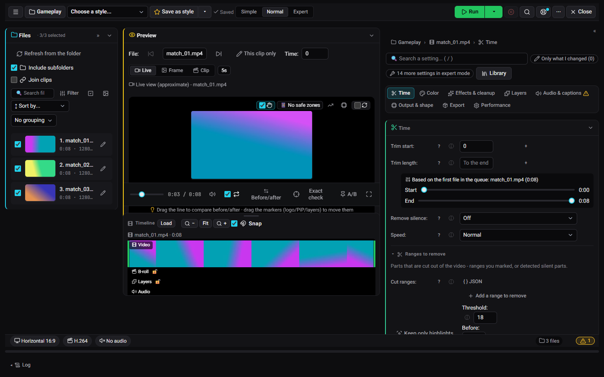
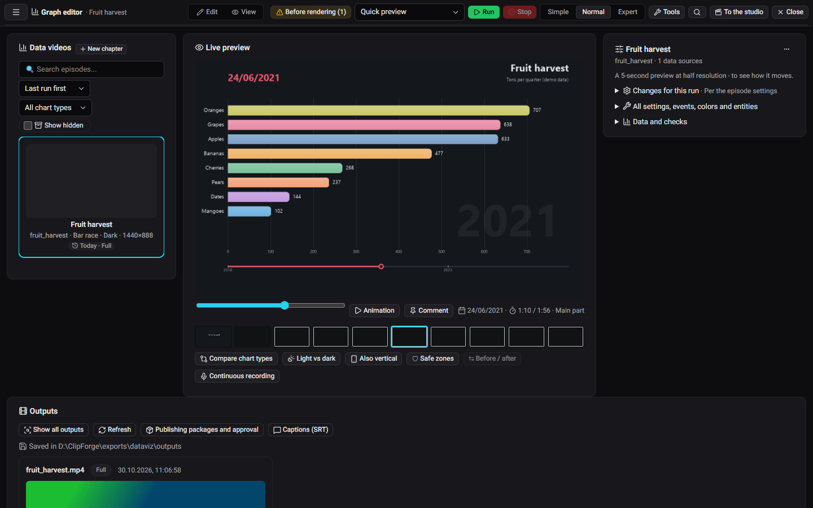
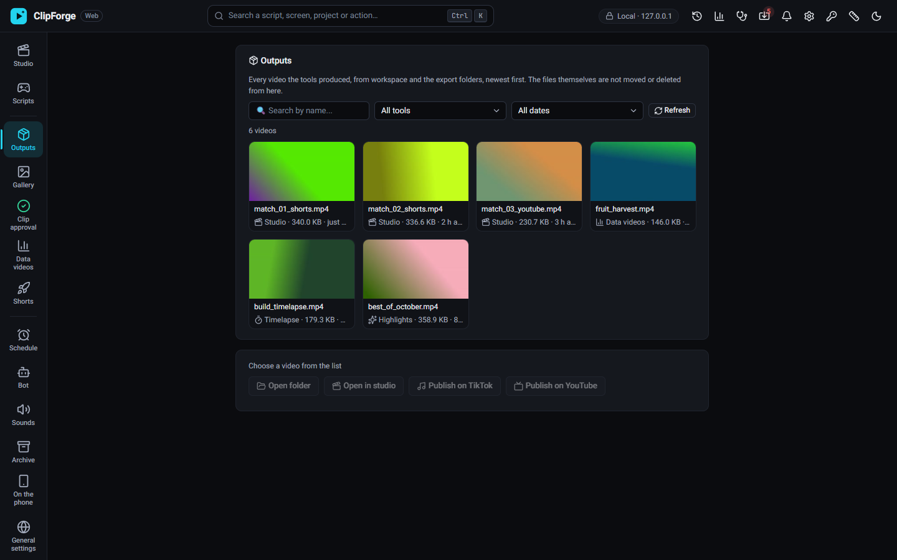
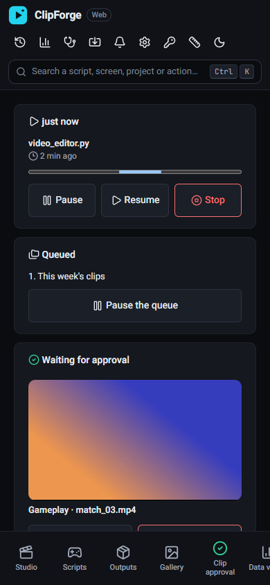
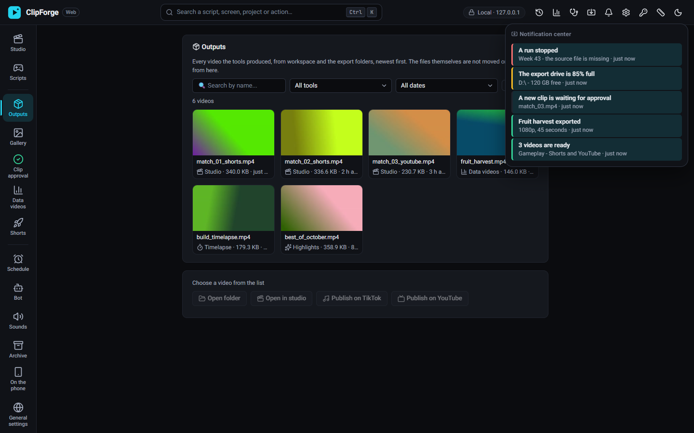

# ClipForge

A video studio for gameplay clips and data videos that runs on your own Windows PC. Edit, brand and export Shorts, TikToks and YouTube videos from your browser, with nothing uploaded anywhere unless you ask for it.

[עברית](README.he.md)

## What it does

- **Studio.** A video editor in the browser. Trim, crop to vertical, add text and image layers, a logo or watermark, captions and loudness normalizing, then export to several targets (Shorts, TikTok, Instagram, YouTube) in one run. The live player shows the result as you edit. Every folder keeps its own project, and you can save your look as a style or a template.
- **Data videos.** Turn a table into an animated chart video (bar races, lines, maps) with titles, narration and captions.
- **Outputs.** Every video you made, in one place, with a player and quick actions.
- **Phone screen.** See what's running, approve clips and run things again from your phone.
- **Notification center.** Finished runs, failures and anything that needs you.
- **Optional automation.** Clip detection, AI titles and descriptions, YouTube upload, a Discord bot, Twitch clip import and an OBS replay watcher. Each one is off until you set it up (see [Optional features](#optional-features)).

| | |
|---|---|
|  |  |
| Data videos editor | Outputs |
|  |  |
| Phone screen | Notification center |

## Install

1. Download the ClipForge zip from the [latest release](../../releases/latest).
2. Extract it to a folder of your choice, for example `C:\ClipForge`.
3. Double-click `ClipForge.vbs`. ClipForge opens in your browser.

There's no installer and no admin rights are needed. Everything stays in that folder, so removing ClipForge means deleting the folder.

### Requirements

- Windows 10 or 11, 64-bit.
- An NVIDIA GPU is optional. With one, exports use the GPU encoder (NVENC) and finish much faster. Without one, ClipForge encodes on the CPU.
- Disk space for the app (about 1 GB) and for your videos.

## Optional features

The studio, the data videos editor and the outputs screen work with no account and no key. The features below each need an account or a key of your own. Without them ClipForge works the same, just without that feature.

| Feature | What you need | How to set it |
|---|---|---|
| Discord bot: approve clips and run tasks from Discord | A Discord bot token | `DISCORD_TOKEN` |
| AI titles, descriptions and clip detection (Gemini) | A Gemini API key | `GEMINI_API_KEY` |
| YouTube upload and channel stats | An OAuth client of type "Desktop app" for the YouTube Data API v3, from Google Cloud | Save it as `client_secret.json` in the ClipForge folder. The first upload asks you to sign in. |
| Twitch clip import | A Twitch app (client ID and secret) and your channel name | `TWITCH_CLIENT_ID`, `TWITCH_CLIENT_SECRET`, `TWITCH_CHANNEL_NAME` |
| OBS replay watcher | OBS with its WebSocket server turned on (Tools, WebSocket Server Settings) | `OBS_WEBSOCKET_PORT` (default 4455) and `OBS_WEBSOCKET_PASSWORD`, if you set one |

Keys go in a text file named `.env` in the ClipForge folder, one per line, for example `GEMINI_API_KEY=your-key`. Add only the ones you use. The 🩺 diagnostics screen shows which keys are set and can check that they still work.

## Privacy

- Everything runs on your PC. Your videos, projects and settings stay in the ClipForge folder (`data/` and `workspace/`).
- The browser screen is served on `127.0.0.1` (localhost) only, and it needs an access token that changes every time ClipForge starts. Opening it from your phone or your local network is off until you turn it on.
- ClipForge goes online only for the features you set up (Gemini, YouTube, Discord, Twitch), to check GitHub for a new version, and to download a speech-to-text model the first time you use captions.

## License

ClipForge is released under the MIT license; see [LICENSE](LICENSE). Third-party parts, including the ffmpeg that comes with the release, keep their own licenses, listed in the notices that ship with it.

## For developers

Running from source, tests and the code layout: [docs/development.md](docs/development.md).
