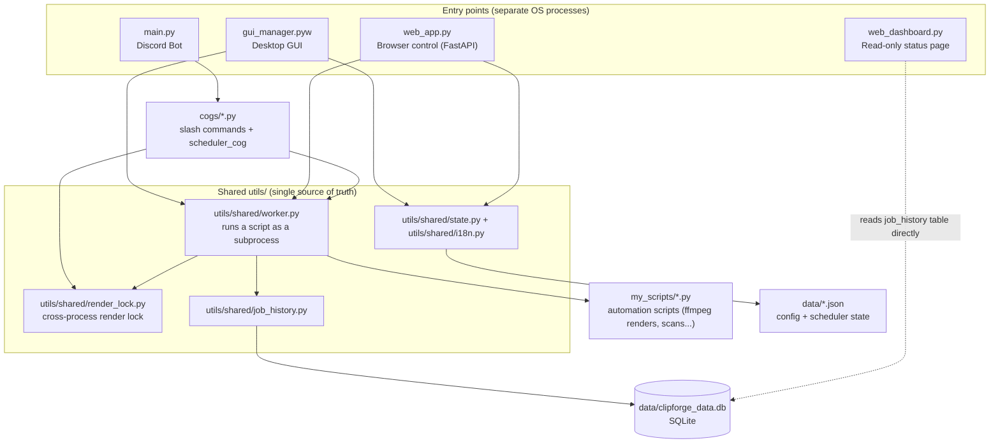

# ClipForge - development

_The user-facing overview, install steps and optional features are in the [README](../README.md) ([עברית](../README.he.md)). This page is for running ClipForge from source: setup, the code layout, tests and tools. It was the README until 30.10.2026._


An internal automation toolkit for video processing, social media content generation (YouTube Shorts/TikTok), and stream monitoring. Features a desktop GUI control center, a companion Discord bot, a local web dashboard, and automated media editing pipelines.

---

## Detailed documentation

- [docs/video_editor.md](video_editor.md) - the Video Editor script and its super-editor options
- [docs/web_ui.md](web_ui.md) - the browser control screen (`web_app.py`)
- [docs/scripts.md](scripts.md) - reference for the other automation scripts
- [docs/dataviz.md](dataviz.md) - data videos (dataviz)
- [docs/scheduling_and_conventions.md](scheduling_and_conventions.md) - script header conventions and scheduling

## Table of Contents

- [Architecture](#architecture)
- [Key Components](#key-components)
- [Setup Instructions](#setup-instructions)
  - [1. Requirements & Dependencies](#1-requirements--dependencies)
  - [2. Environment & Configuration](#2-environment--configuration)
- [Usage](#usage)
  - [Quickest start: `Launcher.vbs`](#quickest-start-launchervbs)
  - [Run Desktop Control Center (GUI) manually](#run-desktop-control-center-gui-manually)
  - [Run Discord Bot](#run-discord-bot)
  - [Run Web Dashboard](#run-web-dashboard)
  - [Run in a Browser (`web_app.py`)](#run-in-a-browser-web_apppy)
  - [Run Individual Automation Scripts](#run-individual-automation-scripts)
  - [Disk Scanner (`my_scripts/tools/disk_scanner.py`)](#disk-scanner-my_scriptstoolsdisk_scannerpy)
  - [Clip Detection & Cutting (`my_scripts/video/story_cutter.py`)](#clip-detection--cutting-my_scriptsvideostory_cutterpy)
  - [Timelapse Maker (`my_scripts/video/timelapse_maker.py`)](#timelapse-maker-my_scriptsvideotimelapse_makerpy)
  - [Highlight Reel Maker (`my_scripts/video/highlight_reel_maker.py`)](#highlight-reel-maker-my_scriptsvideohighlight_reel_makerpy)
  - [Video Editor (`my_scripts/video/video_editor.py`)](#video-editor-my_scriptsvideovideo_editorpy)
  - [Duplicate Scene Detector (`my_scripts/video/duplicate_scene_detector.py`)](#duplicate-scene-detector-my_scriptsvideoduplicate_scene_detectorpy)
  - [Cleanup Old Sources (`my_scripts/video/cleanup_published_sources.py`)](#cleanup-old-sources-my_scriptsvideocleanup_published_sourcespy)
  - [Duplicate Cleaner (`my_scripts/tools/duplicate_cleaner.py`)](#duplicate-cleaner-my_scriptstoolsduplicate_cleanerpy)
  - [Periodic Recap (`my_scripts/video/weekly_compilation.py`)](#periodic-recap-my_scriptsvideoweekly_compilationpy)
  - [Annual "Wrapped" Video (`my_scripts/video/wrapped_generator.py`)](#annual-wrapped-video-my_scriptsvideowrapped_generatorpy)
  - [Data Videos (`my_scripts/video/dataviz_maker.py`, engine in `src/dataviz/`)](#data-videos-my_scriptsvideodataviz_makerpy-engine-in-srcdataviz)
  - [Script Integration Conventions](#script-integration-conventions)
  - [Scheduling (⏰ Scheduler tab)](#scheduling--scheduler-tab)
  - [Build Executable](#build-executable)
  - [Run Tests](#run-tests)
  - [Lint](#lint)
  - [Type Check](#type-check)
  - [Mutation Testing (manual, WSL only)](#mutation-testing-manual-wsl-only)
  - [Performance Benchmarks](#performance-benchmarks)
  - [Dependency Vulnerability Scan](#dependency-vulnerability-scan)
  - [Releasing a new version](#releasing-a-new-version)
  - [CI and security workflows](#ci-and-security-workflows)

---

## Architecture

Four separate processes can run independently (any subset at a time) and communicate only by sharing files on disk - there's no direct network call between them. All first-party Python source (`cogs/`, `ui/`, `utils/`, `entrypoints/`, `scripts/`, `templates/`) lives under `src/` - so a bare mention of e.g. `utils/foo.py` elsewhere in this README means `src/utils/foo.py`. These four processes' own source files live under `src/entrypoints/`:



The key shared pieces that keep the four processes from stepping on each other:
- **`utils/shared/render_lock.py`**: a cross-process file lock (`data/render.lock`) so a render started from the GUI, the scheduler, or a Discord `/run_script` never runs at the same time as another one and fights over the same GPU encoder. `get_status()` is the single source of truth for "who's holding it right now", consumed by the GUI dashboard, `/status`, `web_app.py`'s header, and `utils/shared/diagnostics.py`. `video_editor.py`/`timelapse_maker.py`/`rocket_shorts_publisher.py` also acquire this lock *themselves* now (`render_lock_if_needed()`), so running one of them directly from a terminal - bypassing the GUI/web app/bot entirely - still gets the same protection; `utils/shared/worker.py` and `cogs/remote_execution.py` (which already acquire the lock before launching the subprocess) pass `RENDER_LOCK_HELD_BY_CALLER=1` in its environment so it doesn't try to acquire the same lock again and deadlock against its own parent.
- **`utils/shared/worker.py`**: the only place that actually spawns a `my_scripts/*.py` subprocess, parses its `PROGRESS:`/`RESULT:` stdout lines, and records the outcome via `utils/shared/job_history.py` - the GUI's "Run" button, the scheduler, and `web_app.py`'s `/api/run` all go through this same function instead of each reimplementing subprocess handling. Alongside the percentage, it also pulls the time-remaining estimate `tqdm` already computes and prints inline in its own bar text (e.g. `[06:26<2:45:59, ...]`) - both the desktop progress label and the web app's show it next to the percentage, for every `tqdm`-based script with no per-script changes needed.
- **`data/clipforge_data.db`** (SQLite): job history, pending clip approvals, RSS/Steam tracking state - read by every process, but only ever written by whichever process is actually performing that action.

## Key Components

- **Desktop GUI (`gui_manager.pyw`)**: CustomTkinter control center for managing encoding presets, soundboard, rendering workflows, and local background jobs. Sidebar shows live CPU/RAM, (NVIDIA) GPU/VRAM, and a separate "Encoder (NVENC)" reading - the general GPU% is CUDA/shader engine load, a completely different metric from the dedicated NVENC encode ASIC; a render whose filters (delogo/scale/overlay) run on CPU with only the final encode on the GPU can show near-zero GPU% while NVENC is genuinely maxed out, so the encoder reading is what actually confirms a render is GPU-bound - including a small canvas graph of the last ~3 minutes (`utils/shared/hardware.py`'s rolling history arrays, item 17) underneath the instant percentage bars, so a gradual trend (e.g. a slow RAM leak during a long render) is visible without an external monitoring tool. A separate, longer-range history persists to `data/clipforge_data.db` (`utils/shared/hardware_history.py`, item: historical hardware usage graph) - `get_system_stats()` samples into it (throttled to once a minute so routine 1.5-2s polling doesn't produce tens of thousands of rows a day, auto-pruned past 7 days) so it survives an app restart, unlike the in-memory arrays. The Stats tab shows this as a second, 24-hour graph below the job history list; the web app shows the same 24-hour graph inside the "📊 סטטיסטיקות" dialog (`GET /api/hardware_history`). Both skip the GPU line entirely if any sample in the window has no GPU reading, rather than drawing a misleading flat-zero line. - a "⭐ favorites" section (click the star next to any script; condenses the sidebar to just favorites + recently-run by default once you have any) and a pinned "recently run" shortcut (from job history), lists scripts by human-readable name **and filename** (shown once a script is selected) with a description panel (read from each script's own header, see `utils/shared/script_metadata.py`) plus a ⚡/⚠️ badge for concurrency/file-safety, and supports Hebrew/English (toggle in the "⚙️ הגדרות" tab's "🎨 עיצוב" section, restart required - see `utils/shared/i18n.py`). The "⚙️ הגדרות" tab consolidates design/theme, global (webhook, backup, reset), and Rocket Shorts settings behind one sub-section switcher instead of three separate tabs; per-script settings (working folder, description, script-specific options) live directly in the Dashboard tab next to the Run button - the folder field itself is a normal editable text box (type/paste a path directly), and drag-and-drop of a folder or a single video file works anywhere on the whole window (not just that one field) - a dropped file's parent folder is used, since every script scans a whole `--input_dir`, not a single file. Network services (Docker/ClipForge status switches) live in the "⚙️ הגדרות" tab's "🌐 כללי" section rather than a permanent card next to the log. A "🔧" tools menu in the header holds the less-frequently-used diagnostics and waveform-viewer dialogs. Theme accent color is customizable live (5 presets or a custom color picker, plus a Dark/Light/High-Contrast base palette that - unlike the accent color - needs a restart to apply since `PALETTE` is baked into widgets at construction time), and a one-time welcome dialog on first launch points new users at the key actions - its system-readiness step (item: integrate diagnostics into the first-run wizard) used to just say "click 🩺 up top" as an instruction to go check separately; it now runs `utils/shared/diagnostics.py`'s real `run_diagnostics()` (the same ffmpeg/GPU/DB/disk checks as the standalone "🩺 אבחון מערכת" dialog, not a duplicated list) in a background thread and shows the ✅/❌ results inline in the wizard itself, in the same spot, before you've clicked anything else. Desktop-only - the web app has never had an onboarding wizard to extend this way (it does have its own independent `/api/diagnostics` + diagnostics modal, just not a first-run walkthrough around it). A run always ends with a Windows toast (`utils/shared/notifications.py`); a **heavy** task (a real render, not a quick light-weight script) also gets a "started" toast the moment it begins and a one-time "reached 50%" toast partway through, so you don't have to keep the window open just to know a long render is still progressing - a light script that finishes in seconds skips both of these extra toasts to avoid spamming three notifications for one near-instant run. GUI code is split across `ui/*.py` components rather than one monolithic file - see `ui/widgets.py`, `ui/style_settings_tab.py`, `ui/rocket_settings_tab.py`, `ui/unified_settings_tab.py`.

**Reorderable stats row** (item: reorderable dashboard widgets) - the 5 cards at the top (CPU/RAM/GPU rings, Uptime, Docker) each get a tiny ◀/▶ pair that swaps their position with the neighbor in that logical direction, persisted (`state.dashboard_widget_order_csv`, a CSV of widget IDs surviving restarts) and applied via `rtl_column()` like the rest of the RTL layout - so "put GPU first since that's what I actually watch during a render" is a real, saved preference now, not a fixed order. Implemented as simple prev/next buttons rather than real drag-and-drop, since CTk/Tkinter has no built-in cross-cell grid dragging and building custom drag visuals + drop-zone detection for 5 fixed cards wasn't worth the complexity; the buttons re-`grid()` the existing card widgets into their new column rather than rebuilding them, so nothing that pushes live values into them elsewhere needs to change. Desktop-only - the web app's equivalent hardware readout is a compact sidebar list of bars, not a row of individually movable cards, so there's no matching layout to make reorderable there.
- **Discord Bot (`main.py`)**: `ClipForgeBot` powered by `discord.py` and `aiosqlite`. A configuration error (no `DISCORD_TOKEN`, a token Discord rejects, or the Message Content Intent turned off) prints one clear line and exits with `CONFIG_ERROR_EXIT_CODE` (2), not the crash code 1, so whatever restarts the bot after a crash can stop instead of retrying. Dynamically loads cogs from `src/cogs/` (`approval_cog`, `batch_approval_cog`, `gui_schedule_cog`, `remote_execution`, `rss_monitor`, `steam_monitor`, `scheduler_cog`, `voice_presence_cog`). `scheduler_cog` automatically runs source cleanup daily and an optional weekly recap compilation, both configurable from the GUI's Rocket Settings panel. `/approve_all_pending` and `/reject_all_pending` (`cogs/batch_approval_cog.py`) resolve every clip currently awaiting approval in one shot, instead of clicking ✅/❌ on each one individually - it's a separate cog that calls `approval_cog`'s own `resolve_pending()` for each row rather than duplicating its logic. `/schedule_list`, `/schedule_toggle`, and `/schedule_remove` (`cogs/gui_schedule_cog.py`) read and edit the same `data/scheduled_tasks.json` the GUI's "⏰ מתוזמן" tab manages, so a task can be checked or turned off remotely without opening the desktop app - `toggle`/`remove` autocomplete against the current task list (script name + schedule description, not the internal task UUID). Adding a *new* scheduled task stays GUI-only, since it needs several fields that depend on each other (schedule type → time/weekday/interval) and fits a form much better than a single slash command. Approving/rejecting a pending clip isn't Discord-only either (item: mobile-friendly clip-approval view): both the web app's "✅ אישור קליפים" tab and the desktop's matching tab (`ui/approvals_tab.py`) read/write the same `pending_approvals` table directly via a new `utils/bot/approval_store.py` (sync `sqlite3`, since the bot's own `approval_cog.py` talks to it over `aiosqlite` from a separate process entirely - there's no live connection to share) - approving from the browser moves the file into `rocket_shorts_publisher.py`'s Import folder exactly like clicking ✅ on the Discord embed does, so a clip can be approved from a phone without opening Discord at all.

  `cogs/voice_presence_cog.py` (item: friend detection via Discord voice channel presence) samples, every 60 seconds, who is currently in each voice channel the bot can see, into `voice_presence_snapshots` - deliberately *periodic snapshots*, not `on_voice_state_update` join/leave events: an event log would silently miss anyone already in the channel before the bot started, and desyncs permanently after any bot restart or missed event, whereas a fresh snapshot every minute is self-healing by construction (same reasoning as `utils/shared/hardware_history.py`'s own periodic sampling). Set which voice channel to watch via the "ערוץ קול לזיהוי חברים" field in Rocket Shorts settings (both desktop and web, empty = feature off) - it's a plain settings field, not a slash command, to match how every other Rocket Shorts option already works. When `cogs/approval_cog.py` finds a new clip, it asks this cog who was in that channel within a 120-second window ending at the clip's own file-modified time (`get_present_usernames_for_clip`) and includes them ("👥 עם: ...") in the Discord approval embed - the window exists because a clip's mtime reflects roughly *when it was saved*, not the exact moment the highlight happened (OBS's Replay Buffer saves the last N seconds/minutes *before* the save trigger). The result is cached per clip (`workspace/.friend_tags_cache/`, same `basename.mtime.json` convention as the AI content tags) so the web gallery can show a "👥 Name, Name" badge without asking the bot process anything. This is deliberately an approximation, not exact attendance - it can't be, given the mismatch between "when the clip file was written" and "when the moment actually happened in-game."
- **Web Dashboard (`web_dashboard.py`)**: Local FastAPI/Uvicorn status page (`127.0.0.1:8877`, separate from and much lighter than `web_app.py`'s full control surface on `:8878`) - bot running/not, disk free, uptime, recent job history, RSS/Steam watch lists. Read-only, auto-refreshes every 30s. Its "🗂️ פרויקטים אחרים" section (item: a general control-center for local bots/servers) is a deliberately lightweight extension, not a full rebuild: `discover_sibling_projects()` scans known category folders (`Bots/`, `Apps/`, `Tools/`, `Websites/`, under `PROJECTS_ROOT` - two levels above this project by default, override with `CLIPFORGE_PROJECTS_ROOT`) for sibling project folders and shows a 🟢/🔴/⚪ badge per one, based only on whether any running process's `cwd`/command line points into that folder - generic on purpose, since it knows nothing about how any other project is actually started. This is a status glance, not project management: no start/stop/restart from here, by design. If you already run a proper multi-project launcher/dashboard elsewhere, point *that* at this project's folder instead of relying on this section - it exists for the case where you don't have one yet, not to compete with a purpose-built tool.
- **Automation Scripts (`/my_scripts`)**: Organized by category - `video/` (rendering, cutting, weekly recaps), `stream/` (OBS replay watching, Twitch clip imports), `steam/` (Steam release checks), `tools/` (one-off utilities). The GUI sidebar and the Discord `/run_script` command both discover scripts recursively and derive their category from the subfolder. `/run_script`'s `script_name` field autocompletes against the real file list as you type (case-insensitive substring match, capped at Discord's 25-choice limit) - no more typing an exact filename (`.py` included) from memory.
- **FFmpeg Integration**: Uses local binaries in `ffmpeg/bin/` for media manipulation, resolved through a single shared helper (`utils/shared/ffmpeg_locator.py`).
- **`workspace/`**: All generated/working media lives under here by default, instead of scattered as separate folders directly in the project root next to source code. Two tiers: **raw/pre-render material** (no orientation decided yet) keeps its own top-level folders - `workspace/imports/`, `workspace/clips/`, `workspace/clips_rejected/`, `workspace/Processed_Gameplay/`; **final rendered output** is grouped by tool first, then by orientation or target (since 19.10.2026; one helper, `utils/shared/workspace_dir.tool_output_dir`): `workspace/studio/<horizontal|vertical|square>/` (`video_editor.py`, target subfolders inside), `workspace/timelapses/<orientation>/`, `workspace/highlight_reels/<orientation>/`, `workspace/dataviz/outputs/<orientation>/` + `dataviz/studio_handoff/` + `dataviz/staging/`, and `workspace/rocket_shorts/<YouTube|TikTok|Instagram|square>/` (the weekly recap and Wrapped are written next to Rocket's outputs). Caches live in `workspace/.cache/`. Before that it was orientation first (`workspace/horizontal/edited_videos/` etc.); `dev/migrate_workspace_layout.py` moves existing outputs (dry run by default, `--apply` to move; never overwrites), and readers still find an old folder if only it exists. Gitignored entirely (machine-specific, often large). Configurable per-script (e.g. Rocket Shorts' Import/Export paths in its settings panel) if you'd rather point at an external drive - the orientation split still applies underneath whatever base folder you choose.

---

## Setup Instructions

### 1. Requirements & Dependencies
- Python 3.10+ (`.python-version` pins 3.14 for local dev via `uv`; the code itself only requires 3.10+, see `pyproject.toml`)
- FFmpeg (pre-bundled in `/ffmpeg/bin/ffmpeg.exe`, or installed globally)

Install required Python packages with [uv](https://github.com/astral-sh/uv) (preferred). The project ships a `pyproject.toml` + `uv.lock`, so `uv sync` creates `.venv` and installs the exact locked dependency versions in one step - this is what `Launcher.vbs` runs automatically:
```bash
uv sync
```

Or with plain pip (uses `dev/requirements.txt`'s looser `>=` version bounds, not the exact lockfile - fine for a quick start, but `uv sync` is the reproducible path):
```bash
pip install -r dev/requirements.txt
```

### 2. Environment & Configuration
Copy the example configuration files and populate them with your credentials:

```bash
cp .env.example .env
cp data/config.example.json data/config.json
cp data/rocket_settings.example.json data/rocket_settings.json
```

- **`.env`**: Add your `DISCORD_TOKEN`. Secrets are managed through `python-dotenv` and `utils/shared/secrets_vault.py` (which supports system keyring integration). `utils/shared/credential_health.py` can check these are still valid, not just present - the "🩺 אבחון מערכת" diagnostics dialog (both UIs) always shows which of `GEMINI_API_KEY`/`TWITCH_CLIENT_ID`+`SECRET`/`DISCORD_TOKEN` are configured (instant, no network at all), and a separate "🔑 בדוק תוקף Credentials" button triggers the real check - a lightweight, free API call per service (Gemini's `models.list()`, Twitch's OAuth client-credentials grant, Discord's `/users/@me`) that actually confirms the key still works, rather than just that a value exists. Kept as an explicit, on-demand action rather than running automatically, so opening the diagnostics dialog never silently makes outbound API calls on your behalf.

  **Key-age tracking** (item) - a credential can be valid and still dangerously old. `utils/shared/credential_rotation.py` stamps a rotation timestamp every time `secrets_vault.set_secret()` actually writes a value (the one-time vault migration, or rotating a key from either UI's diagnostics dialog going forward) into `data/credential_rotation.json` (gitignored, machine-specific, never the secret value itself) - the same dialog now shows each key's age next to its validity ("⚠️ 200 ימים מאז הסבב האחרון" past a 90-day default) alongside a password-masked field to actually rotate it in place, rather than only ever being able to check whether a key still works. A key set manually in `.env` (never through the vault) shows as "age unknown" rather than falsely flagged as stale - there's no way to know when a plain-text `.env` edit happened.
- **`data/config.json`**: General bot configuration and fallback token storage.
- **`data/rocket_settings.json`**: Video rendering bitrates, resolution presets, and directory paths for exports.
- **`data/`**: also holds the runtime SQLite DB (`clipforge_data.db`) and the render counter (`counter.txt`) - all gitignored, all machine-specific. Every path under it comes from `utils/shared/data_dir.py`, and the `CLIPFORGE_DATA_DIR` environment variable points the whole folder somewhere else. `tests/conftest.py` sets it to a temporary folder for every pytest run, so no test (and no script a test launches as a subprocess) ever writes to the real `data/`. `tests/infra/test_tests_never_touch_real_data.py` guards this.

---

## Usage

### Quickest start: `Launcher.vbs`
Double-click `dev/Launcher.vbs` (it left the project root on 23.10.2026 - the main entry point is `WebLauncher.vbs` there). It's the only file actually meant to be double-clicked - the batch script it wraps (`dev/_launcher_impl.bat`) lives in a separate folder and is named with a leading underscore specifically so it doesn't look like a second launch option (a `Launcher.bat` sitting next to `Launcher.vbs` is too easy to click by mistake, and a `.bat` run directly always opens a CMD window no matter what's inside it). `Launcher.vbs` runs `dev/_launcher_impl.bat` completely hidden and only pops up a message box if something actually fails. On first run it bootstraps a `uv`-managed `.venv` and installs dependencies automatically; on later runs it just verifies dependencies are up to date and launches the Desktop Control Center. This is the single entry point for the whole system - the GUI it opens can start/stop the Discord bot, run any automation script, and edit all settings from one place. All bootstrap output goes to `data/logs/launcher.log` (there's no visible console to print to) - check there if the message box reports a failure.

Because the GUI itself runs via `pythonw.exe` (no console), any `subprocess` call it makes (or that a script it launches makes) would otherwise flash its own brand-new console window open-and-closed by default on Windows - `utils/shared/subprocess_flags.py`'s `NO_WINDOW_FLAGS` (passed as `creationflags=` everywhere the codebase shells out - GUI polling loops, "Run Script"/"Start Bot", ffmpeg/ffprobe/nvidia-smi calls in `my_scripts/*.py` and their `utils/*.py` helpers, the Discord cogs) prevents that.

### Run Desktop Control Center (GUI) manually
```bash
uv run python src/entrypoints/gui_manager.pyw
```
(`uv run` picks the project's `.venv` automatically - a bare `python ...` uses whatever `python` resolves to on `PATH`, which usually isn't this venv and is missing the dependencies below.)

"🔗 פייפליין" next to the Run/Stop buttons opens a dialog for chaining several scripts on the same working folder - e.g. `story_cutter.py` → `video_editor.py` → `rocket_shorts_publisher.py` run automatically in sequence, each step starting only after the previous one succeeds. A failed step stops the chain there instead of running the rest on whatever partial output exists; auto-backup and night-mode auto-shutdown only trigger once the whole chain finishes, not after each intermediate step.

The "🔍" button next to it toggles a search bar over the Dashboard tab's own console (the current script's live output) - same highlight-all-matches behavior as the "🔍 חיפוש" button already in the unified log at the bottom of the window, just scoped to a single run's output instead of the whole session's stdout/stderr.

"⏸️ השהה" next to Stop freezes the running script (and any child process it spawned, e.g. `ffmpeg`) via `psutil.suspend()` instead of killing it - zero CPU/GPU usage while paused, with no progress lost; "▶️ המשך" resumes it exactly where it was. Available in the browser too (`web_app.py`'s matching pause/resume buttons). Useful for freeing up the machine mid-render without losing the work already done. A paused *heavy* (GPU) run keeps holding `utils/shared/render_lock.py`'s cross-process lock the whole time it's paused (it's still "running", just frozen) - a background refresh keeps that lock from being mistaken for stale during a long pause.

A few seconds after startup, the GUI checks GitHub Releases (`utils/shared/update_checker.py`, in a background thread so it never blocks the UI) against `utils/shared/version.py`'s `APP_VERSION`, and pops a small dialog with a link to the release page if a newer tag is published. Fails silently on any network error or if no release has been published yet, rather than showing an alarming error for what's a non-critical check.

That dialog's "⬇️ עדכן עכשיו" button (item: true auto-update) actually applies the update now, instead of only linking to the release page: `apply_update()` runs `git pull --ff-only` then `uv sync` against the project's own working directory - the same two commands you'd run by hand, just behind one button with an explicit yes/no confirmation first (never automatic). This repo doesn't publish a pre-built binary/zip as a GitHub Release asset (no workflow does that - see `.github/workflows/ci.yml`), so "download and install a build" wouldn't have anything reliable to fetch; a git-based update matches how the project is actually distributed and run (`Launcher.vbs` already calls `uv sync` on every launch). Refuses outright if `git status --porcelain` shows uncommitted local changes, rather than risking a pull that conflicts with them, and `--ff-only` means it never attempts a merge or conflict resolution on your behalf - either the fast-forward succeeds cleanly or the whole thing fails with a clear message and touches nothing. Available in the browser too (`web_app.py`'s update banner gets the same button, `POST /api/update_check/apply`) - both surfaces need a restart afterward for the change to take effect, since neither relaunches the process for you.

### Run Discord Bot
```bash
uv run python src/entrypoints/main.py
```
If the bot process exits unexpectedly (not via the GUI's "Stop Bot" button), `ui/bot_tab.py` restarts it automatically, up to 5 times within a 5-minute window (`utils/shared/crash_supervisor.py`) - beyond that it's treated as a persistent failure and stops retrying, showing "crashed - manual restart needed" instead of looping forever. Use the `/status` slash command (`cogs/status_cog.py`) for a one-shot health snapshot - uptime, free disk space, Docker container status, last automated-maintenance run dates, and the most recent audit-log entry - instead of running `docker_status`/`audit_log` separately. The audit log (`utils/bot/audit_log.py`) covers `web_app.py`'s actions too, not just Discord commands - each entry is tagged 🤖 (Discord) or 🌐 (web, identified by IP since the web app has no per-user login) so `/audit_log` shows one unified trail. Beyond run/stop, the web app now also logs every other state-changing action reachable from the browser: token rotation, settings reset/import, scheduler task add/delete, RSS feed and Steam game add/delete, "undo last move batch," the credential-validity check, and the TikTok/YouTube export wizard - so the trail reflects everything that actually changed something, not just script runs.

### Run Web Dashboard
```bash
uv run python src/entrypoints/web_dashboard.py
```
Read-only status page (bot running?, disk free, uptime, recent jobs) - see `web_app.py` below for an interactive alternative that can actually trigger runs.

### Run in a Browser (`web_app.py`)

Quickest start: double-click `WebLauncher.vbs` in the project root (mirrors `dev/Launcher.vbs`'s pattern exactly, via `dev/_web_launcher_impl.bat`) - it starts the server hidden, waits for it to actually come up, and opens your default browser straight to the correct token URL. No terminal, no copying a URL out of a log file. Failures go to `data/logs/web_launcher.log`.

Full details: [docs/web_ui.md](web_ui.md).

### Run Individual Automation Scripts
```bash
uv run python my_scripts/stream/obs_replay_watcher.py
uv run python my_scripts/video/rocket_shorts_publisher.py
```
`obs_replay_watcher.py` also supports an optional global "Clip That!" hotkey (`rocket_settings.json`'s `clip_hotkey`, empty by default - set it from either UI's Rocket Shorts settings) that actively tells OBS to save its Replay Buffer over the same websocket connection, registered system-wide via the `keyboard` package - useful as an alternative to configuring a hotkey inside OBS itself, or when OBS's own hotkey doesn't reach a fullscreen-exclusive game window. Registration failures (or no hotkey set at all) are logged and don't stop the rest of the watcher from working.

**Second capture-tool integration** (`my_scripts/stream/capture_folder_watcher.py`) - OBS exposes a real websocket API to react to (`obs_replay_watcher.py` above), but Streamlabs/SLOBS and NVIDIA ShadowPlay/Instant Replay don't have an equivalent common API this project can hook into, and each user configures their own output folder for these tools anyway - so instead of (fragile, soon-stale) per-tool integrations, this watches one folder (`rocket_settings.json`'s `capture_watch_dir`, empty by default - set it, with a folder picker, from either UI's Rocket Shorts settings, right next to the voice-channel field) via simple periodic polling (`utils/media/capture_watcher.py`, every 3 seconds - no new dependency like `watchdog`, just `os.scandir`) and copies any new video file into the Import folder once its size stops changing across two consecutive checks (proof the capture tool has finished writing it, not a partial/corrupt copy). This makes it work with *any* folder-based capture tool, not just two named ones. Same copy-not-move semantics as the OBS watcher (the original stays where the capture tool put it), and the same long-running "start it and leave it running, stop it from the GUI" script shape.
```bash
uv run python my_scripts/stream/capture_folder_watcher.py
```

### Disk Scanner (`my_scripts/tools/disk_scanner.py`)

**Archived** (item: Super Manager) - superseded by `super_manager.py --mode scan` below, still fully functional and directly runnable, just no longer listed in the main script list (see "Archive tab" further down). Recursively scans a drive/folder (default `D:\`), read-only - never modifies, moves, or deletes anything. Runs ffprobe on every recognized media file (codec, bitrate, duration, resolution), finds duplicate files via a tiered hash strategy (size match -> quick partial hash -> full SHA-256 only for real candidates, so it doesn't fully hash every large video on a multi-TB drive), and flags common junk files (Thumbs.db, desktop.ini, 0-byte files, corrupted media). Writes everything to a single `data/report.json`.

Full details: [docs/scripts.md](scripts.md).

### Clip Detection & Cutting (`my_scripts/video/story_cutter.py`)

Scans long gameplay recordings in a folder, finds candidate highlight moments by audio loudness peaks (dBFS), filters out ones with no accompanying visual motion (OpenCV frame-diff), then sends surviving candidates to Gemini AI to confirm they're an actual interesting moment and identify the game - clips are cut and sorted into `clips/<game name>/`.

Full details: [docs/scripts.md](scripts.md).

### Timelapse Maker (`my_scripts/video/timelapse_maker.py`)

**Archived** (item: Archive tab) - superseded by `video_editor.py --target-seconds` (identical underlying speed/atempo logic, plus watermark/captions/LUT/everything else this script doesn't offer), still fully functional and directly runnable, just no longer listed in the main script list. Compresses long recordings (even multiple hours) into a short, very-fast-motion clip by speeding up the whole video with ffmpeg's `setpts` filter - not highlight detection like `story_cutter.py`, everything in the source plays, just compressed into a fixed target duration (60s by default). Produces both a horizontal (1920x1080) and a vertical (1080x1920, center-cropped) version per source video, written to `timelapses/`:

Full details: [docs/scripts.md](scripts.md).

### Highlight Reel Maker (`my_scripts/video/highlight_reel_maker.py`)

Merges several clips into one summary video - e.g. point it at the folder `approval_cog.py` moves Discord-approved clips into, and get one combined reel instead of manually stitching them elsewhere:

Full details: [docs/scripts.md](scripts.md).

### Video Editor (`my_scripts/video/video_editor.py`)

General-purpose quick-edit script, meant as the base for more one-off editing operations later - unlike the other `video/` scripts (which each do one specific job), this one composes several independent, optional operations in a single ffmpeg pass:
- **Watermark/logo overlay** (`--watermark_path`, `--watermark_position top-left|top-center|top-right|bottom-left|bottom-center|bottom-right|center`, `--watermark_scale` as a fraction of output width (now a slider/field in both UIs, not just a CLI-only flag), `--watermark_opacity` 0.0-1.0, default 1.0 = fully opaque) - geometry (size/position, aspect-ratio preserved) is computed in pure Python (`utils/video/video_editor.py`) from the watermark image's real dimensions, not guessed. Both UIs show a live preview of this before you run anything, using the same `compute_watermark_geometry()`/`resolve_output_dimensions()` the real ffmpeg command uses - so what you see is what the render will produce, not an approximation - and updates live as you change the watermark file, its position/scale, or the vertical/horizontal toggle. `--watermark_opacity` applies `format=rgba,colorchannelmixer=aa=X` before the overlay (the same technique `rocket_shorts_publisher.py` already used) - ignored with `--hwaccel`, since the `nv12` pixel format the watermark gets converted to there before `overlay_cuda` has no alpha channel at all, so there's no way to express partial transparency on that path without dropping back to CPU (which would defeat the point of `--hwaccel`); the render still succeeds, just fully opaque.
  - **Free placement by dragging the preview** (`--watermark_x`/`--watermark_y`, both required together, each a 0.0-1.0 fraction of output width/height for the watermark's *center*) - overrides `--watermark_position` entirely when both are set, for a spot no fixed preset covers. Both UIs let you just drag the watermark thumbnail around directly on the live preview instead of typing fractions by hand (desktop: a Tkinter drag on `wm_preview_label`; web: a `mousedown`/`mousemove`/`mouseup` drag on `#wmPreviewImg`) - dragging derives the center fraction from wherever you drop it and writes it back into the same fields. Using the *center* rather than the top-left corner means changing the scale afterward doesn't shift the point you actually dragged to. Picking a position from the dropdown again clears the custom fraction so the preset takes over; a dedicated "↩️ בטל מיקום מותאם"/"clear custom position" button does the same without touching the dropdown.
- **Old watermark removal/replacement** (`--remove_watermark_position` with the same position choices, `--remove_watermark_width_fraction`/`--remove_watermark_height_fraction` as fractions of the *input's* own width/height, default 0.2/0.12) - erases that rectangular region with ffmpeg's `delogo` filter, run at the input's native resolution before any scaling. This blurs/interpolates the region from its surroundings rather than reconstructing genuinely hidden detail - clean on simple backgrounds, a visible soft patch on busy/detailed ones. Combine with `--watermark_path` (same run) to place a new logo over the erased area, or anywhere else - that's a "replace watermark A with watermark B" edit in one pass, not two separate scripts.
- **Vertical conversion** (`--vertical`) - same 1080x1920 TikTok/Shorts crop as `timelapse_maker.py`, or 1920x1080 horizontal (default) otherwise. `--smart-crop` (vertical only, ignored otherwise) picks where that crop window sits instead of always centering it - `utils/media/smart_crop.py`'s `compute_horizontal_crop_offset()` samples ~40 frames, tracks where most of the motion happens via optical flow, and returns a -1.0 (all the way left) to 1.0 (all the way right) offset baked directly into the `crop` filter's `x` expression, so action happening off-center doesn't get cut off by a naive center crop. A failed analysis (or none requested) falls back to the original centered behavior exactly. See `--blur-background` below for a way to convert to vertical *without* cropping the source at all.

Full details: [docs/video_editor.md](video_editor.md).

### Archive tab for scripts a "super" script has made fully redundant (item)

A new "🗄️ ארכיון"/"Archive" tab in the top nav (`web_app.py`'s `ARCHIVED_SCRIPTS`, a small fixed set - not a generic tagging mechanism) lists scripts that a unifying "super" script (see below, and `video_editor.py` above) already covers *completely*, so they no longer clutter the main script list - they're still fully runnable, just one click away in this dedicated tab instead (clicking one switches to the Scripts tab with it already selected). Scoped deliberately narrow: a script only qualifies once nothing it does is missing from its replacement - `timelapse_maker.py` (superseded by `video_editor.py --target-seconds`) and the six scripts Super Manager/Super Streamer absorb (see below) qualify; scripts that only *partially* overlap (`rocket_shorts_publisher.py`, `story_cutter.py`, `duplicate_scene_detector.py`, `file_renamer.py` - each has a genuine capability no unifying script replaces) stay in the main list on purpose.

Full details: [docs/web_ui.md](web_ui.md).

### Duplicate Scene Detector (`my_scripts/video/duplicate_scene_detector.py`)

Finds scenes that repeat *within* a single video - a loading screen that shows up twice, a segment accidentally recorded twice - as opposed to `duplicate_cleaner.py` below, which finds whole duplicate *files*. Read-only, writes only a JSON report (`workspace/reports/disk/duplicate_scenes_report.json` by default):

Full details: [docs/scripts.md](scripts.md).

### Duplicate Cleaner (`my_scripts/tools/duplicate_cleaner.py`)

**Archived** (item: Super Manager) - superseded by `super_manager.py --mode clean` below, still fully functional and directly runnable, just no longer listed in the main script list. Reads the duplicate groups from an existing `report.json`, keeps one copy per group (oldest by default, `--keep newest` to flip that) and moves the rest to the **Recycle Bin only** (via `send2trash` - never a permanent delete). Running it with no flags (including from the GUI's Run button, which can't pass custom flags) is always a dry-run plan that moves nothing; add `--execute` from the command line to actually move files:

Full details: [docs/scripts.md](scripts.md).

### Super Manager - מנהל-העל (`my_scripts/tools/super_manager.py`)

Unifies Disk Scanner + Duplicate Cleaner + `report_to_excel.py` (converts an existing `report.json` to a formatted Excel without re-scanning - never had its own README section) into one script with a `--mode scan|report|clean` selector, the same way `video_editor.py` unifies many independent video operations - except unlike `video_editor.py`'s single composed ffmpeg pass, these are three genuinely separate jobs with three separate outputs (a scan produces `report.json`, `clean` reads one and moves files, `report` reads one and writes an `.xlsx`), so a mode here *selects* one job rather than *composing* several into one. Each mode is a thin dispatch to the original script's own `main()` (dynamically loaded via `importlib`, `sys.argv` filtered to just that mode's own recognized flags via `parse_known_args()`'s own leftover list - not a hand-rolled `sys.argv` filter, which would leak the `--mode` value itself in as a stray positional argument) - behavior is byte-for-byte identical to running the original script directly, this is purely a UI/discoverability unification, not a rewrite:

Full details: [docs/scripts.md](scripts.md).

### Super Streamer - משדר-העל (`my_scripts/stream/super_streamer.py`)

Unifies Twitch Clip Import + OBS Replay Watcher + Capture Folder Watcher into one script with a `--mode twitch|obs|folder` selector - all three ultimately do the same thing ("get clips into the Import folder"), just from a different capture source, so unlike Super Manager's three-separate-outputs design this is closer to `video_editor.py`'s spirit (one underlying goal, several interchangeable ways to reach it) even though the *mechanics* still don't compose into one pass: `twitch` is a one-shot batch download that runs and exits, while `obs`/`folder` are long-running listeners that run until stopped (same "🛑 עצור" button in both UIs that already stops any long-running script). Same dispatch mechanism as Super Manager - `obs_replay_watcher.py`/`capture_folder_watcher.py` got a small refactor (their existing `if __name__ == "__main__":` block moved into a proper `def main():`, identical behavior, just matching `twitch_clip_import.py`'s existing convention) so all three can be dispatched to uniformly:

Full details: [docs/scripts.md](scripts.md).

### Cleanup Old Sources (`my_scripts/video/cleanup_published_sources.py`)

Moves (never deletes) source clips into an `Archived_Sources` subfolder once they're older than both `--retention_days` and the last successful `rocket_shorts_publisher.py` run recorded in `job_history` - a file that predates the last publish has almost certainly already been processed (every run scans the whole Import folder). Runs from the GUI's scheduler or manually; with no `--retention_days` (and none set in `rocket_settings.json`'s `cleanup_retention_days`) it's a no-op.
- **Undo last move batch** (`utils/shared/move_undo_log.py`) - every successful (non-dry-run) run records the exact source→destination pairs it moved to `data/last_move_batch.json` (gitignored, only the most recent run - not a full history). An "↩️ בטל פעולה אחרונה" button appears in both UIs' history panel (desktop `ui/stats_tab.py`, web `web_app.py`'s `/api/undo/status` + `/api/undo/last_move_batch`) whenever a batch is pending, moving every file back to where it came from. A file whose archived copy no longer exists, or whose original location is now occupied by something else, is skipped rather than overwritten or erroring out the whole undo. This is scoped to this one script - `duplicate_cleaner.py` below moves files to the Recycle Bin via `send2trash`, which already has its own OS-level undo (restore from Recycle Bin) and no simple cross-platform "restore to this exact original path" API to build a matching feature on.

Full details: [docs/scripts.md](scripts.md).

### Periodic Recap (`my_scripts/video/weekly_compilation.py`)

Concatenates the YouTube (or TikTok, `--source tiktok`) clips published in the last N days into a single recap video, plus a `<output>.chapters.txt` sidecar - one `timestamp name` line per clip, starting at `0:00`, ready to paste into the YouTube description so YouTube auto-detects it as a chapters list (needs at least 3 clips of 10+ seconds each to actually activate on YouTube's side; not enforced here, the file is generated either way). `--period week|month|year` is a convenience for `--days 7|30|365` respectively (an explicit `--days` always overrides `--period`); the output filename reflects the period (`Weekly_Recap_...`/`Monthly_Recap_...`/`Yearly_Recap_...`), and a previous recap's own output is always excluded from being swept up as an input clip into the next one. Tries a fast `-c copy` concat first, falling back to a full re-encode if the clips don't share identical codec parameters.

Full details: [docs/scripts.md](scripts.md).

### Annual "Wrapped" Video (`my_scripts/video/wrapped_generator.py`)

A Spotify-Wrapped-style yearly recap (item: annual "Wrapped" video) - distinct from Periodic Recap above in both scope and time range: `--period year` there means "the last 365 rolling days" and just concatenates every clip; `--year` here (default: the current calendar year) means "your 2026", and opens with a handful of stat title cards before the clips themselves. Runs like any other script (auto-discovered in both the desktop sidebar and the web app's script list under "🎬 פייפליין וידאו" - no dedicated settings panel, since a once-a-year action with sensible defaults doesn't need one) with `--source youtube|tiktok` selecting the same published-clips folder Periodic Recap reads from.

Full details: [docs/scripts.md](scripts.md).

### Data Videos (`my_scripts/video/dataviz_maker.py`, engine in `src/dataviz/`)

"Data is Beautiful" style videos (bar chart race and more) as a series. Each episode is a folder under `data/dataviz_episodes/<name>/` with a `config.yaml` (title, chart type, theme, sources, events, notes, intro/outro, music) and its data files; defaults match the first episode, so a new one only states what differs. `src/dataviz` is an isolated package (no imports from the rest of ClipForge): `sources/` reads CSV/Excel/JSON into one time/entity/value table and spreads yearly or monthly totals over days, `plan.py` computes every frame without drawing (adaptive pacing so no bar moves more than 0.5% of the axis per frame, slowdown around events, smoothed ranking and axis, event cards, "new record"), `charts/` draws one frame from the plan, and `render.py` renders in parallel processes piped into ffmpeg with the music trimmed and faded. The input folder is an episode folder or a folder of episodes; output goes to `workspace/<orientation>/dataviz/`:

Full details: [docs/dataviz.md](dataviz.md).

### Script Integration Conventions

Every `my_scripts/*.py` file starts with a small comment header parsed by `utils/shared/script_metadata.py` - see `templates/script_template.py` for a copyable starting point covering all of this:
- `# Name:` / `# Name (EN):` and `# Description:` / `# Description (EN):` - display name/description shown in the GUI sidebar (Hebrew/English).
- `# Concurrency: light` (optional, default `heavy`) - opts a fast, non-GPU script (e.g. `disk_scanner.py`, `file_renamer.py`) into a small concurrent pool in `utils/shared/worker.py`, so it can run immediately instead of queueing behind a long `ffmpeg` render (shown with a ⚡ prefix in the sidebar). Leave unset for anything GPU/CPU-heavy (video encodes) so it stays serialized.
- `# Safety:` (**required** - `read-only` or `modifies`) - whether the script ever renames/moves/deletes a pre-existing file (creating new output files doesn't count). Shown as a ⚠️ prefix in the sidebar for `modifies`; nothing shown for `read-only`. Missing/invalid values are treated as `modifies` (the conservative default) by `get_script_metadata()`, but the header-convention test requires every script to state it explicitly. `read-only` is enforced, not just documented - `tests/bot/test_read_only_scripts_do_not_mutate_files.py` statically scans (via `ast`, not regex) every `read-only`-tagged script for calls to `os.remove`/`os.rename`/`os.replace`/`os.rmdir`/`os.unlink`/`shutil.move`/`shutil.rmtree`/`send2trash`. A call to one of those needs a `# safe: ...` comment justifying it on that exact line (e.g. cleaning up a temp file the script created itself, not the user's real input) or the test fails - forcing either that justification or an honest `modifies` tag, instead of a script silently drifting out of sync with its own safety label.

Full details: [docs/scheduling_and_conventions.md](scheduling_and_conventions.md).

### Scheduling (⏰ Scheduler tab)

Tasks can also be created from the web super-editor (⏰ button) - they keep the input folder and the editor's exact flags (`folder`/`extra_args` in the task), and the web app itself now checks due tasks every 30 seconds, so scheduled runs fire even when only the browser interface is running.

Full details: [docs/scheduling_and_conventions.md](scheduling_and_conventions.md).

### Documentation Search
```bash
uv run python dev/docs_search.py "watermark opacity"
```
A personal search index over this project's own documentation (`README.md` - which, at this size, doubles as a running decision log where every feature explains *why* a particular approach was chosen, not just what it does - plus `docs/*.md`). A terminal tool, not a GUI script - it doesn't fit the "select a folder, click Run" model every other script uses (`web_app.py`'s `/api/run` requires a valid `--input_dir` for any script; a documentation search has no folder to point it at, just a text query), so it lives in `dev/` alongside `build_exe.py`/`generate_app_icon.py` rather than `my_scripts/`. Splits each document into sections by markdown heading, then does a simple case-insensitive substring search (`utils/shared/job_history.py`'s `search_jobs()` - not a real full-text index, `LIKE`-style matching is enough for a document this size) across both headings and body text - a heading match ranks well above a body-only match. Each result shows the source file, line number, and a short context snippet around the match, so you can jump straight to the right spot instead of `Ctrl+F`-ing through a multi-thousand-line file guessing at wording. `--limit N` caps how many results print (default 10).

### Build Executable
To package the Desktop GUI into a standalone Windows binary via PyInstaller:
```bash
uv run python dev/build_exe.py
```
The result lands in `dist/Launcher/`, and the build script also copies the project's `.venv` into `dist/Launcher/venv/` - "Run Script" and "Start Bot" spawn subprocesses, and in a frozen exe `sys.executable` is the exe itself, not a Python interpreter, so they need a real one with the project's exact dependencies (tqdm, openpyxl, pydub, etc.) available; the bundled venv provides that without requiring a separate Python install. If it's missing (e.g. an older build, or `.venv` didn't exist at build time) it falls back to a global `python`/`py` on `PATH`, and reports clearly if neither is found instead of silently doing nothing. The packaged `.exe`, the desktop window/taskbar icon, and the system tray icon all use `assets/app_icon.ico`/`app_icon.png` - regenerate them with `uv run python dev/generate_app_icon.py` if you want to change the branding.

### Run Tests
```bash
uv run pytest tests/
```
With a coverage report (`utils/`, `cogs/`, `my_scripts/` only - `gui_manager.pyw`/`ui/*` are interactive Tkinter code that never runs under pytest, so including them would just show a permanent, meaningless 0%):
```bash
uv run pytest tests/ --cov --cov-report=term-missing
```
CI (and this command locally) fails if coverage drops below 55% (`[tool.coverage.report] fail_under` in `pyproject.toml`) - a floor meant to catch an actual regression (new code shipped with no tests), not a hard target; raise it as real coverage grows rather than leaving it stale.

Faster, the way CI runs them (wave 23) - everything except the real-browser tests in parallel, then the browser tests:
```bash
uv run pytest tests/ -m "not browser" -n auto --dist loadgroup --cov --cov-report=term-missing
```
```bash
uv run pytest tests/ -m browser -n 2 --dist loadgroup
```

Tk/GUI tests (anything importing `tkinter`/`customtkinter`/`ui.*`) get the `tk` marker automatically from `tests/conftest.py`. CI runs them as a separate parallel job: the main unit job uses `-m "not browser and not tk"` and the Tk job uses `-m tk -n auto --dist loadgroup`. Locally the `-m "not browser"` command above still runs them too.

`tests/test_web_app.py` was split by topic into `tests/web/test_web_app_{build_args,clips,video,settings,youtube,runs,system,core}.py`; their shared helpers/fixtures live in `tests/web_app_support.py`.

### Lint
```bash
uv run ruff check .
```

### Type Check
```bash
uv run mypy
```
Scoped (via `[tool.mypy]` in `pyproject.toml`) to `utils/` modules with no dependency on `discord.py`/`customtkinter`/`pystray`/`keyboard`/`winsound`/`winotify` (none of which have type stubs) rather than the whole codebase - most of it was written without type hints from the start, so running mypy project-wide would surface thousands of pre-existing findings with no real signal. Grown from the original 5 files to 45 - every other dependency-light `utils/` module, which turned out to already be clean (only two needed an actual fix to pass: `script_metadata.py`'s cache dict needed an explicit type, `secrets_vault.py`'s `keyring = None` fallback needed a `# type: ignore[assignment]`, the standard pattern for an optional-import fallback). New small, pure-logic modules are expected to add type hints and a `files` entry here from day one instead.

### Mutation Testing (manual, WSL only)
```bash
uv run mutmut run
uv run mutmut results
```
[mutmut](https://mutmut.readthedocs.io/) checks whether the test suite would actually *catch* a bug, not just execute the line - it mutates the source (flips a comparison, changes a constant, etc.) and confirms some test fails; a mutation nothing catches is a real gap even at 100% line coverage. **It refuses to run on native Windows at all** (WSL/Linux only - this project's own dev environment and CI are Windows, so this can't be run or verified from either). `[tool.mutmut]` in `pyproject.toml` scopes `only_mutate` to a handful of pure, cross-platform `utils/` modules already covered by direct tests (`video_editor.py`, `timelapse.py`, `retry.py`, `disk_space.py`, `render_lock.py`, `ffmpeg_progress.py`, `rtl_layout.py`, `seo_generator.py`, `backup_sync.py`) rather than the whole codebase - most other modules import Windows-only packages (`winsound`, `pystray`, `keyboard`, `winotify`) that won't even load under Linux. Not wired into CI for the same reason it can't run here at all; run it yourself from WSL if you want this signal.

### Performance Benchmarks

```bash
uv run pytest tests/infra/test_benchmarks.py --benchmark-enable --benchmark-autosave
# ...make a change, then compare against the saved baseline:
uv run pytest tests/infra/test_benchmarks.py --benchmark-enable --benchmark-compare
```
`tests/infra/test_benchmarks.py` (item: dev/infra - benchmark suite for render-performance regression tracking) times the pure-Python computations that actually run per-frame/per-folder/per-render decision: `compute_render_signature` (smart re-encode skip's hashing), `find_video_files_by_folder` (the `--input_dir` recursion added this round, over a synthetic 40-folder/200-file tree), and the perceptual-hashing duplicate-detection functions (`compute_average_hash_from_gray`, `hamming_distance`, `compute_frame_match_fraction`, `find_cross_file_duplicate_pairs` - the last two are the ones actually worth watching, since they're O(frames²) and O(files² × frames²) respectively, exactly where an innocent-looking change could quietly turn a fast path into a slow one). Deliberately **not** a real-ffmpeg-render-time benchmark - actual encode wall-clock time depends on GPU/CPU/thermal state and isn't reproducible enough across machines or CI runs to compare meaningfully; this covers the deterministic logic that feeds those decisions instead.

By default (plain `pytest tests/`, including CI) these run with `--benchmark-disable` (set in `addopts`) - each benchmarked function runs exactly once as an ordinary correctness assertion, no timing, no added suite runtime. Real timing plus the save/compare workflow above is opt-in only, same reasoning as mutmut above: comparing absolute wall-clock time across separate CI runs on shared, non-dedicated runners isn't reliable enough to gate on, so this stays a local, on-demand developer tool rather than a hard CI check. Results save under `.cache/benchmarks/` (gitignored, same as every other tool cache here).

### Dependency Vulnerability Scan
```bash
uv run pip-audit
```
Checks every locked dependency (`uv.lock`) against the PyPI Advisory Database / OSV for known CVEs - catches a vulnerable version landing via a routine `uv sync` before it ships, not just at release time. Runs in CI on every push/PR; a real finding fails the build.

A GitHub Actions workflow (`.github/workflows/ci.yml`) runs tests+coverage, lint, the type check, and the dependency scan automatically on every push/PR.

### Roadmap
The roadmap is kept outside the repository; [CHANGELOG.md](../CHANGELOG.md) records what shipped in each version.

### Releasing a new version
The public repository is published from the development repository with `dev/export_public.py`, one commit per version, so
its history never needs a force-push:

1. In the development repository: set the new version in `pyproject.toml` and `src/utils/shared/version.py`, add its
   section to `CHANGELOG.md` (the section becomes the Release notes), and merge to `master`.
2. Export into a clean clone of the public repository:
   ```bash
   uv run python dev/export_public.py --update ..\clipforge-app
   ```
   It extracts the files tracked at `origin/master` (`--ref` for another commit) into a temporary folder and scans them
   for secrets and personal details first - a finding stops it (exit code 2 or 3) and the clone stays as it was. Then it
   replaces the clone's tracked files, deletes the ones no longer exported (`.git`, `dist/` and anything in
   `.gitignore` are left alone), and makes one commit, "ClipForge <version>", with a `Source:` line of short commit
   hashes. No change means no commit. It never pushes, and refuses a clone with unsaved work.
3. Review the commit in the clone, then push it: `git -C ..\clipforge-app push`.
4. Tag the version there and push the tag: `git tag v1.2.0` and `git push origin v1.2.0`. The tag starts
   `.github/workflows/release.yml`, which checks that the tag matches the version, builds the portable zip with the
   pinned FFmpeg (`dev/build_portable.py`), and creates the GitHub Release with the zip, `SHA256SUMS.txt` and the
   `CHANGELOG.md` section, with the zip's SHA-256 in the notes.

`dev/build_portable.py` writes `dist/SHA256SUMS.txt` next to the zip (`sha256sum -c SHA256SUMS.txt` checks it). For a
Release made by hand, upload `SHA256SUMS.txt` together with the zip.

To try the zip before tagging, run `uv run python dev/build_portable.py` in the clone. Keep the clone at a short path:
the build's staging folder sits under it, and a deep one makes Windows fail to load the packaged Python's DLLs.

Each Release also carries a build-provenance attestation for the zip and `SHA256SUMS.txt`
(`actions/attest-build-provenance`); `gh attestation verify <zip> --repo DrummingBird1/clipforge-app` checks that a
download was built by this repository's workflow from its tag.

### CI and security workflows
| Workflow | Runs on | What it does |
|---|---|---|
| `ci.yml` | every PR; pushes to `main` (public repository); `workflow_dispatch` | lint (`ruff`, `mypy`, `pip-audit`) and the unit tests on `windows-latest`; the Tk and browser tests on PRs and by hand |
| `release.yml` | a `v*` tag | builds the portable zip, attests it, and creates the Release |
| `codeql.yml` | PRs, pushes to `main`, weekly | CodeQL for Python and JavaScript - public repository only |
| `scorecard.yml` | pushes to `main`, branch-protection changes, weekly | OpenSSF Scorecard, published and uploaded to code scanning - public repository only |
| `pages.yml` | pushes to `main` that touch `docs/`, `mkdocs.yml`, `README.md`, `CHANGELOG.md` or `ROADMAP.md`; `workflow_dispatch` | builds the documentation site with `mkdocs build --strict` and deploys it to GitHub Pages - public repository only |

Every action is pinned to a full commit SHA, with its version in a comment; update the SHA and the comment together.
CodeQL and Scorecard skip a private repository (`github.event.repository.private`), where code scanning needs a paid
plan.

To turn them on in the public repository: enable Actions; leave code scanning's "Default setup" off, because `codeql.yml`
is the advanced setup; and protect `main` with a rule that requires the `lint` and `unit` checks to pass.

The documentation site (from November 1, once Actions runs again): in the public repository, set Settings > Pages >
Source to "GitHub Actions", then run `pages.yml` once by hand. `mkdocs.yml` builds the site from `docs/`, and
`dev/mkdocs_hooks.py` adds `README.md`, `CHANGELOG.md` and `ROADMAP.md` from the repository root and points their links
at the site's pages. Preview it locally with `uv run mkdocs serve`; `uv run mkdocs build --strict` fails on a broken
link to a page or a heading, as the workflow does.

### Pre-push hooks (optional)
`.pre-commit-config.yaml` now has pre-push hooks for `mypy`, a fast Tk/GUI test subset (~10s) and `pip-audit`, next to the full pytest hook. Not enabled automatically: `pip install pre-commit && pre-commit install --hook-type pre-push`. Offline push: `SKIP=pip-audit git push`.

### Dataviz additions

Chart types `bump_race` and `heatmap_race`; episode settings editable in the browser (stored in `data/dataviz_overrides/<episode>.json`, `config.yaml` is never written); approved publish packages can be sent via dry-run / copy to the Rocket Shorts input folder / private YouTube upload (explicit confirmation, off by default); a missing ETA for `PROGRESS:`-only scripts is estimated from progress + `job_history`.

Full details: [docs/dataviz.md](dataviz.md).
