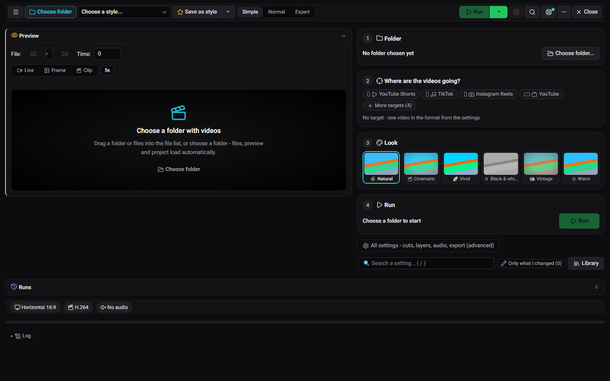
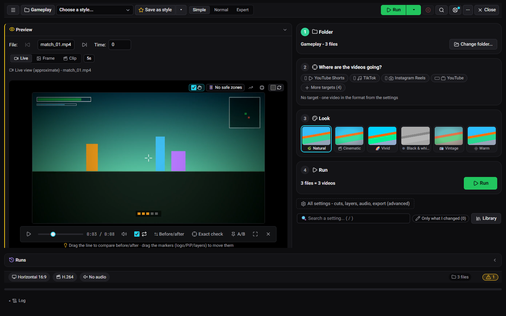
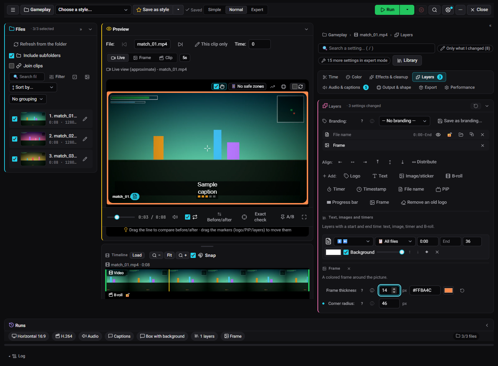

# Your first video in 5 minutes

This walks through the studio's **Simple mode**, from a folder of clips to finished videos. You need ClipForge installed (see [Install](../README.md#install) in the README) and a few video files. Everything stays on your PC.

## 1. Open the studio with a folder

Start ClipForge: double-click `ClipForge.vbs`, or start it from the Start menu if you installed it with Scoop. It opens in your browser. Click **Studio** in the left sidebar.

Click **Choose folder** and pick a folder with a few clips, or drag the folder (or the files) into the file list. The files, a live preview and the project for that folder load by themselves. Every folder keeps its own project, so your choices are still there the next time you open it.

## 2. Pick where the videos are going

Under **Where are the videos going?**, tap one or more targets: **YouTube Shorts**, **TikTok**, **Instagram Reels** or **YouTube**. **More targets** has the rest. Each target gets its own video, in its own format, from a single run. With no target you get one video in the format set in the settings.

## 3. Pick a look

Under **Look**, choose **Natural**, **Cinematic**, **Vivid**, **Black & white**, **Vintage** or **Warm**. The live player shows it right away, so you can try them one after the other. **Before/after**, under the player, compares the result with your original clip.

## 4. Run

The **Run** card says what is about to happen, for example "3 files = 3 videos". Press **Run**. The **Runs** bar at the bottom shows what is running.

## 5. Find your videos

Finished videos appear in **Outputs** (left sidebar): every video you made, newest first, with a player and quick actions. They are saved in the `workspace` folder next to `ClipForge.vbs`, or in the export folder you chose in the settings.

## Going further

- **Normal and Expert modes** (the switch at the top of the studio) open every setting: cuts, color, effects, layers, audio and captions, output and export.
- **Layers** go on top of the picture: a logo, text, an image, a timer, a timestamp, the name of the source file, a frame (with optional rounded corners) and a progress bar. Drag them in the live player to move them.
- **Captions** are written by speech-to-text on your PC and burned into the video. They need the clip's audio. You choose the font, color and position, and a line length so that long captions wrap.
- **Save as style** keeps your whole setup, so you can use it on the next folder.

More: the [studio reference](video_editor.md), [data videos](dataviz.md), and the [optional features](../README.md#optional-features) (AI titles, YouTube upload, a Discord bot and more).
